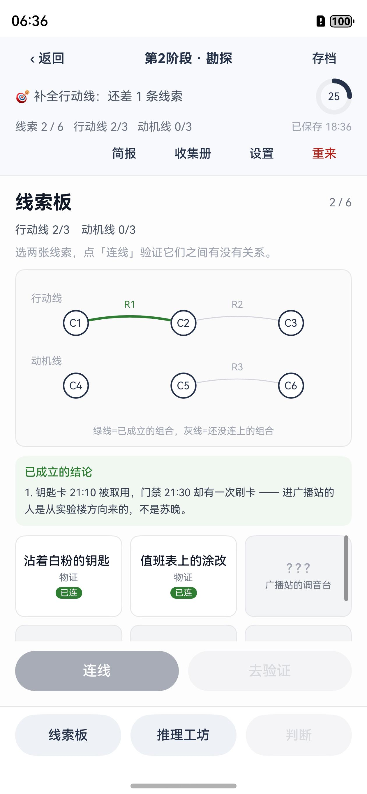

# 校园线索推理与多结局探索 App（`campus-case`）

HarmonyOS 单机推理叙事 App《钟楼七点》：场景探索 → 线索收集 → 组合验证 → 最终判断 → 多结局，带线索板、HUD、阶段进度、存档与杀进程恢复。

> **状态**：完整可玩，模拟器实测通过全链路；Hypium 单元测试 22/22、演示流水线 24/24。
> **平台**：HarmonyOS NEXT（ArkTS + ArkUI，API 12+），单 HAP，纯离线、无任何权限声明。

---

## 1. 功能

- **探索**：4 个场景（旧钟楼条件解锁）、12 个事件节点，热点有「可调查 / 已调查 / 未解锁 / 已封锁」四态
- **线索**：6 条线索，线索板两两连线产出 3 条结论，Canvas 证据链图实时变绿
- **推理**：两关证据链验证，通过后出现「可推理」，才能进入最终判断
- **结局**：2 个互斥结局（E-A《七点钟声》/ E-B《留白》），收集册记录解锁时间
- **状态反馈**：HUD 常驻阶段 / 目标 / 线索计数 / 双链进度 / 进度环
- **持久化**：Preferences 快照 + RDB 五表（事实、流水、存档槽、结局、设置），自动槽 + 3 个手动槽
- **恢复**：杀进程后重开仍停在同一进度（`aa force-stop` 实测）
- **设置**：动画减弱、字号三档（1.0 / 1.2 / 1.5）、清空进度
- **分支真实生效**：撬锁拿 C1 会永久关闭群消息节点 → 拿不到 C4 → 动机线断裂 → 只能走结局 B

## 2. 开发环境

| 项 | 版本 / 说明 |
| --- | --- |
| IDE | DevEco Studio 5.0.5 |
| 语言 / 框架 | ArkTS + ArkUI（Stage 模型） |
| SDK | HarmonyOS NEXT 5.0.5(17) |
| 构建 | hvigor 5.17.5；命令行走 `tools/build-harmony.ps1` |
| 测试依赖 | `@ohos/hypium` 1.0.21、`@ohos/hamock` 1.0.0 |
| 设备 | DevEco 模拟器 API 17（`hdc list targets` → `127.0.0.1:5555`） |
| 辅助 | Python 3.12、PowerShell 5.1+、hdc |
| 路径 | 仓库需放在纯 ASCII 路径（本机 `E:\campus-case`），hvigor 拒绝中文路径 |

## 3. 运行方法

```powershell
# 1) 准备内容副本（clone 下来 rawfile 是空的，不跑会白屏）
powershell -File tools/sync-case.ps1

# 2) DevEco → File → Open → E:\campus-case\harmony（选 harmony 子目录），等 Sync 完成点 ▶ Run

# 3) 或纯命令行
powershell -File tools/build-harmony.ps1
$hdc = 'D:\huawei\DevEco Studio\sdk\default\openharmony\toolchains\hdc.exe'
& $hdc install -r harmony\entry\build\default\outputs\default\entry-default-unsigned.hap
& $hdc shell aa start -a EntryAbility -b com.nacl1yan.campuscase
```

## 4. 截图与录屏

真实设备录制（`tools/device-capture.sh` 逐帧抓取 + `tools/make-demo-gif.py` 合成）：
启动 → 接案 → 三处取证 → 线索板连线 → 两关验证 → 判断 → 《七点钟声》→ 收集册。


| 简报 | 线索板 | 结局 |
| --- | --- | --- |
|  |  |  |

更多截图见 `docs/screenshots/`（共 18 张，含大字号、分支证据、单测结果）。

## 5. 测试

| 命令 | 覆盖 | 实测 |
| --- | --- | --- |
| `python tools/preflight.py` | 配置/资源/符号/导入/生成物静态检查 | PASS 8 / FAIL 0 |
| `python tools/validate.py` | 内容完整性 + 42 条判定用例 | 42/42 |
| `powershell -File tools/build-harmony.ps1` | 主模块 + 测试模块编译 | RESULT: PASS |
| Hypium（IDE Run 或 `aa test`） | 22 个 `it`：正常 6 / 边界 8 / 异常 8 | 22/22 |
| `powershell -File tools/e2e.ps1 -Scenario all` | 主线 / 撬锁分支 / 存档三条链路 | 24/24 |

用例逐条清单见 `docs/TestReport.md` §1.1；Hypium 的命令行跑法与三个坑见 `docs/03-编译与单测检查单.md` §2。

## 6. 仓库结构

```
campus-case/
├─ docs/        规格、检查单、演示对照、测试报告、截图、录屏、原始日志
├─ shared/      唯一内容源：case/（案件 JSON）+ fixtures/（42 条判定用例）
├─ harmony/     DevEco 工程（交付对象）
└─ tools/       同步 / 预检 / 校验 / 编译 / 演示流水线 / 录屏 / 图标
```

## 7. 文档

| 文档 | 内容 |
| --- | --- |
| [docs/README](docs/README.md) | 文档索引与阅读顺序 |
| [01-基础功能需求规格说明](docs/01-基础功能需求规格说明.md) | FR-01～17、模块与接口、数据模型、验收标准、测试要求 |
| [02-内容与剧情设计规范](docs/02-内容与剧情设计规范.md) | 内容 schema 与规模约束 |
| [03-编译与单测检查单](docs/03-编译与单测检查单.md) | 构建与单测步骤、报错对照 |
| [04-演示与验收对照](docs/04-演示与验收对照.md) | 演示脚本、需求→证据对照、已知限制 |
| [TestReport](docs/TestReport.md) | 测试结果、缺陷根因、未执行项 |
| [PROGRESS](docs/PROGRESS.md) | 进度快照与踩坑记录 |

## 8. 提交规范（摘要）

- 任何修改完成后立即 commit + push，工作区保持干净
- 提交信息格式 `<type>(<scope>): <中文摘要>`，一次提交一件事
- 改判定逻辑要同步 `docs/01`；改内容格式要同步 `docs/02`

完整规则见 [docs/01 §13](docs/01-基础功能需求规格说明.md)。
