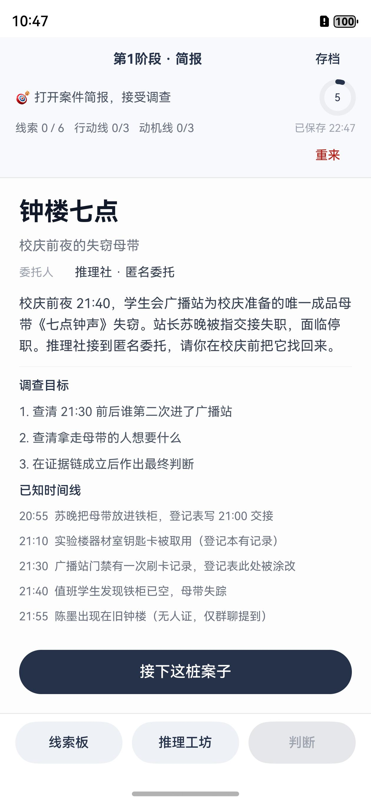
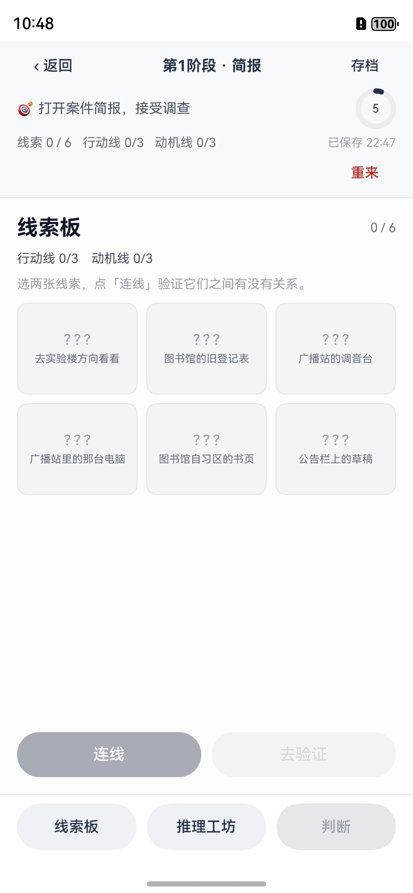
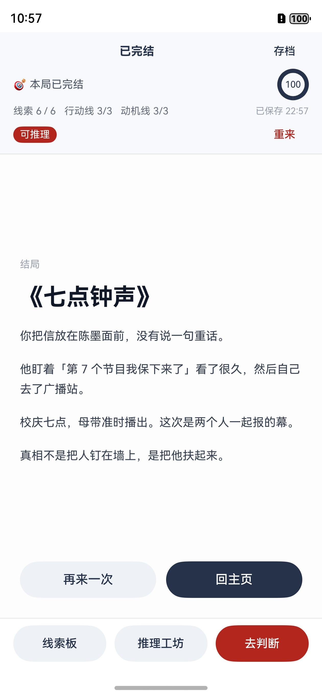
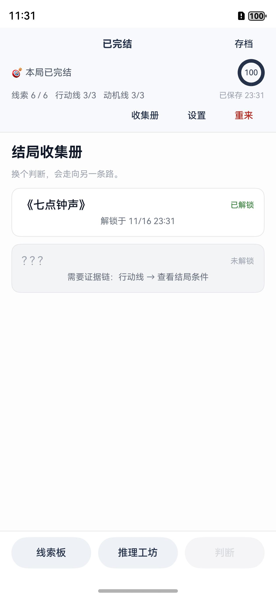
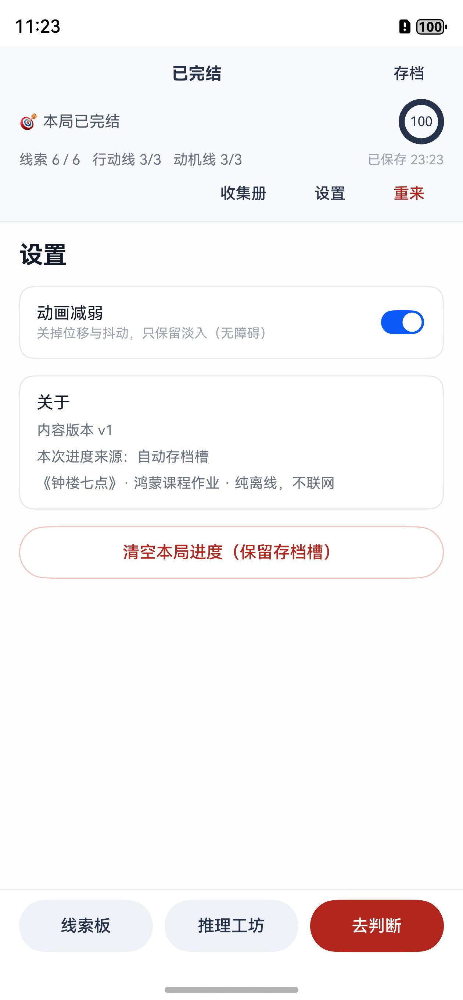
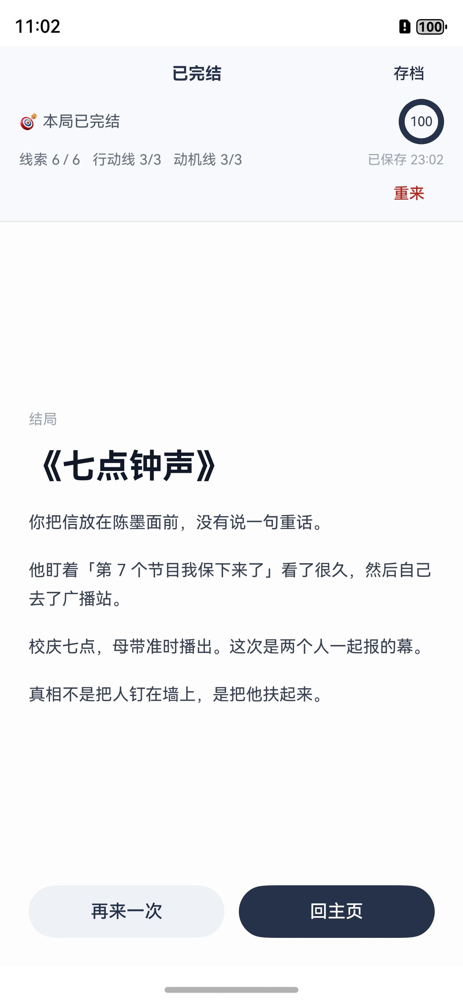

# 校园线索推理与多结局探索 App（`campus-case`）

HarmonyOS 单机推理叙事 App《钟楼七点》：场景探索 → 线索收集 → 组合验证 → 最终判断 → 多结局，带线索板、HUD、阶段进度、存档与杀进程恢复。

> **当前状态**：鸿蒙版**完整可玩**——模拟器实测全链路、存档、杀进程恢复、收集册、设置持久化，Hypium 单元测试 22/22。

- 平台：HarmonyOS NEXT — ArkTS + ArkUI（API 12+），单 HAP，纯离线，**无任何权限声明**
- 内容只有一份源：`shared/case/campus_001.json`，构建期复制进 rawfile；判定用例 `shared/fixtures` 同时喂养 ArkTS 单测
- 技术栈重点：声明式状态管理、组件动画、领域建模、KV + 关系型双存储、单元测试（Hypium）
- Android 版（Kotlin + Compose）早期做过、现已冻结并归档在 tag `archive/android-v1`，`main` 只保留鸿蒙版

---

## 1. 文档与仓库结构

### 1.1 文档索引

| 文档 | 内容 | 状态 |
| --- | --- | --- |
| [docs/README](docs/README.md) | **文档索引**：每份文档管什么、什么时候看 | — |
| [01-基础功能需求规格说明](docs/01-基础功能需求规格说明.md) | 软件基础功能 FR-01～FR-17、通用规则、验收标准、测试要求 | v1.6 定稿 |
| [02-内容与剧情设计规范](docs/02-内容与剧情设计规范.md) | 内容 schema、规模约束、校验规则 | v0.1 骨架 |
| [03-编译与单测检查单](docs/03-编译与单测检查单.md) | 从零到「构建绿 + Hypium 22/22」的步骤、期望输出、报错对照 | v2.0 |
| [04-演示与验收对照](docs/04-演示与验收对照.md) | 十分钟演示脚本、需求→实现→证据对照、分支演示、已知限制、交付物清单 | v1.1 |
| [TestReport](docs/TestReport.md) | 自动化检查结果 + 真机功能验证 + 缺陷根因 + 未执行项 | v1.1 |
| [PROGRESS](docs/PROGRESS.md) | 收工快照：做完什么、下一步、踩过的坑 | 每日更新 |
| [drafts/剧情草案-v0](docs/drafts/剧情草案-v0.md) | 早期含具体剧情的混写版，仅作素材保留 | 草案，不采用 |

**阅读顺序**：先看 `01` 的「§3 通用规则」和「§4 功能需求」，那是所有实现的判定依据；再看 `03` 怎么跑起来、`04` 怎么演示给老师看；`02` 只定内容长什么样。

### 1.2 仓库结构

```
campus-case/
├─ docs/                 # 规格、检查单、演示对照、测试报告、截图与日志（索引见 docs/README.md）
├─ shared/               # 唯一内容源：case/（案件 JSON）+ fixtures/（42 条判定用例）
│                        #   构建期复制进 harmony 的 rawfile，副本不入库
├─ harmony/              # DevEco 工程（ArkTS + ArkUI，交付对象）
└─ tools/                # 同步 / 预检 / 校验 / 编译 / 演示流水线 / 图标生成
```

`shared/` 不允许出现任何平台代码；`harmony/` 不允许自己复制一份剧情。
Android 版工程已从 `main` 移除，归档在 tag `archive/android-v1`。

---

## 2. 提交规范（**硬规则**）

### 2.1 总则

> **任何一次修改完成后，必须立即提交（commit）。** 不允许把"已完成但未提交"的交付物留在工作区过夜。

| 规则 | 说明 |
| --- | --- |
| R1 修改即提交并推送 | 文档定稿、功能实现、缺陷修复，任务结束时工作区必须干净（`git status` 无输出），且已推到 `origin/main` |
| R2 一次提交一件事 | 不把"改需求 + 改代码 + 调样式"塞进同一个 commit；能一句话说清才提交 |
| R3 可回滚粒度 | 每个提交单独能通过构建/测试；不允许提交"半截功能导致跑不起来"的状态 |
| R4 文档与实现同步 | 改判定逻辑 → 同步改 01 文档对应 FR；改内容格式 → 同步改 02；两者不一致时以文档为准并补齐文档 |
| R5 提交前自检 | 跑完 §2.5 清单再提交，不靠"先提交再说" |

**允许不提交的中间态**：仅限编辑器自动保存、临时草稿（放在 `scratch/`，已被 `.gitignore` 忽略）。一旦进入 `docs/`、`entry/` 等交付目录，就必须提交。

### 2.2 提交信息格式

```
<type>(<scope>): <中文摘要，≤ 50 字，不加句号>

<可选正文：为什么改、影响哪些 FR / AC，每行 ≤ 72 字>

<可选脚注：Refs: FR-04 / AC-05>
```

**type**

| type | 用途 | 示例 |
| --- | --- | --- |
| `feat` | 新增功能 | `feat(clueboard): 实现线索两两连线与规则校验` |
| `fix` | 修缺陷 | `fix(save): 修复读档后 seq 与流水冲突` |
| `docs` | 只改文档 | `docs(requirements): 补充 FR-14 恢复流程` |
| `refactor` | 不改行为的重构 | `refactor(domain): 抽出 Condition 统一求值器` |
| `test` | 只加/改测试 | `test(domain): 补 TC-15 双链成立用例` |
| `style` | 格式/命名/注释 | `style: 统一热点状态命名` |
| `chore` | 构建、依赖、配置 | `chore: 加入 DevEco 构建忽略规则` |
| `content` | 只改内容 JSON | `content(case): 补 N05 节点与对应线索` |
| `revert` | 回滚 | `revert: feat(clueboard) 连线重绘抖动` |

**scope 取值**（统一用，便于按模块查历史）
`requirements` `content` `engine` `ui` `state` `storage` `recovery` `test` `build` `docs`

### 2.3 提交粒度示例

| 场景 | 拆法 |
| --- | --- |
| 实现"线索板连线" | ① `feat(engine): checkCombine 规则校验` ② `feat(ui): 线索板卡槽与选中态` ③ `feat(ui): 连线曲线动画与持久重绘` ④ `test(engine): 补 TC-09~TC-12` |
| 修"杀进程丢档" | ① `fix(storage): 节点应用后改为事务立即落盘` ② `fix(recovery): seq 对账不一致时回放流水` ③ `test(recovery): 补 TC-24/TC-25` |
| 需求调整 | ① `docs(requirements): FR-09 改为选项灰显可见` ② 代码跟改 `feat(judge): 选项可见性按链计算` |

**禁止**：`update`、`fix bug`、`修改一下`、`提交`、`1`、`asdf` 这类无信息量的信息。

### 2.4 分支与标记

| 项 | 约定 |
| --- | --- |
| 主干 | `main`（远程已设同名主干，`git branch -m main` 已完成） |
| 远程 | `origin` = `https://github.com/NaCl1Yan/campus-case.git`（**私有**，交作业如需对外可见要改公开或加协作者） |
| 特性分支 | `feat/<scope>-<简述>`，如 `feat/clueboard-link`；单人开发可直接在 `main` 上小步提交，超过 1 天的改动开分支 |
| 里程碑标记 | 每个里程碑验收通过后打 tag：`m1-skeleton` `m2-engine` `m3-ui` `m4-persistence` `m5-release` |
| 版本标记 | 可交付版本打语义化 tag：`v0.1.0`（M3 可玩）、`v1.0.0`（验收通过） |
| 回滚 | 优先 `git revert <sha>`（保留历史）；禁止对已推送历史 `reset --hard` |

> **网络提示**：本机到 GitHub 的 443 时通时断（会被重置），本地 Clash（`127.0.0.1:7890`）对 `github.com` 也会偶发握手失败。仓库**不设**代理配置，push 失败时两种都试：
> - 直连：`git push`
> - 临时代理：`git -c http.proxy=http://127.0.0.1:7890 push`
>
> 先用 `curl.exe -s -o NUL -w "%{http_code}" https://github.com` 判断：返回 `200` 就走直连，`000` 就换代理。

### 2.5 提交前检查清单

```
[ ] git status 里没有不该提交的东西（见 .gitignore）
[ ] 文档：新增链接可达、表格未错位、TBD 只出现在确实待定的位置
[ ] 需求变更是否已同步到 01/02 文档（R4）
[ ] 代码：hvigorw assembleHap 通过；hvigorw test 通过
[ ] 新增逻辑是否补了对应 TC 用例（对照 01 文档 §10.2）
[ ] commit 信息符合 §2.2，摘要能独立看懂
[ ] 本次提交只做了一件事（R2）
```

### 2.6 每轮任务的收尾动作（固定流程）

1. 完成修改 → 跑检查清单
2. `git add <path>`（按文件加，别一把 `-A` 兜底，能防止误提交）
3. `git commit -m "<type>(<scope>): <摘要>"`
4. 用 `git log --oneline -1` 确认提交成功
5. `git push`（首次已 `-u`，之后直接 push）
6. 若本轮涉及需求判定变化，在回复里点明"改了哪个 FR、影响哪个 AC"

> 提交记录本身是验收证据：AC-05（分支真实生效）、AC-12（杀进程恢复）、AC-17（单测）都能通过对应 commit 的 diff 与测试结果追溯。远程仓库则保证换机、误删后进度可恢复。

---

## 3. 忽略规则速览

`.gitignore` 已覆盖：DevEco 构建产物（`build/`、`.hvigor/`、`.preview/`、`*.hap`）、依赖（`oh_modules/`、`node_modules/`）、签名与本地配置（`local.properties`、`*.p12`、`*.cer`、`*.p7b`、`*.keystore`、`signature/`）、构建期复制的内容副本（`harmony/**/rawfile/case/`）、系统与编辑器垃圾文件、临时草稿（`scratch/`、`tmp/`）、Python 缓存（`__pycache__/`）。

---

## 4. 当前进度

| 阶段 | 状态 |
| --- | --- |
| 需求文档（FR-01～17） | ✅ v1.6 |
| 内容（4 场景 / 12 节点 / 6 线索 / 2 结局） | ✅ 《钟楼七点》真实文案 |
| `domain/` 判定引擎 | ✅ 真编译 + 42 条 fixtures |
| 引擎与测试模块编译 | ✅ `tools/build-harmony.ps1` → RESULT: PASS |
| UI（13 个视图 + HUD） | ✅ 单页路由 + 全部页面；线索板含 Canvas 证据链图 |
| Preferences + RDB（五表） | ✅ 快照 + 事实层 + 自动/手动存档 |
| 冷启动恢复（杀进程） | ✅ 实测停在「已完结 100%」 |
| 动画（6 类） | ✅ 转场/进度环/获得/抖动/阶段/打字机 |
| 结局收集册 | ✅ RDB `t_ending_seen` + 页面，含解锁时间 |
| 设置 / 返回键 | ✅ 动画减弱、**字号三档**、清空进度、关于；子页拦截返回键 |
| Hypium 用例「执行」 | ✅ IDE Run 与 `aa test` 均 **22/22**（截图 `docs/screenshots/hypium-run-22.png`，日志 `docs/evidence/hypium-aa-test.log`） |
| 演示流水线 E2E | ✅ 三条链路 24/24（`tools/e2e.ps1 -Scenario all`） |

**现在的样子**：

| 简报 | 线索板 | 结局 |
| --- | --- | --- |
|  |  |  |
| **收集册** | **设置** | **恢复后** |
|  |  |  |

## 5. 如何验证

```powershell
# 1) 离线预检（配置/资源/符号/导入/生成物一致性，只需 Python）
python tools/preflight.py                 # 期望：PASS 8 / FAIL 0

# 2) 内容校验 + 规格自检（42 条判定用例）
python tools/validate.py                  # 期望：内容通过 + 42/42

# 3) 鸿蒙工程编译（主模块 + 测试模块）
powershell -File tools/build-harmony.ps1  # 期望：RESULT: PASS

# 4) 单元测试 22 个 it（IDE 里右键 Run，或见 docs/03 §2 的命令行跑法）

# 5) 装到模拟器并驱动点击（开发期自动化，可选）
powershell -File tools/sync-case.ps1
powershell -File tools/ui-tap.ps1 -Text "接下这桩案子"
powershell -File tools/ui-tap.ps1 -Dump

# 6) 三条演示链路一次跑完并自动断言（模拟器在线）
powershell -File tools/e2e.ps1 -Scenario all   # 期望：24/24
```

> **路径要求**：hvigor 拒绝含中文的工程路径（`Invalid project path`），仓库已迁到纯 ASCII 的 `E:\campus-case`，
> 所以 `build-harmony.ps1` 现在**原地构建**（产物 `harmony/entry/build`）；万一仓库又落在中文路径下，
> 脚本会自动镜像到 `%LOCALAPPDATA%\campus-case-build` 再构建。

演示与验收对照见 [04-演示与验收对照](docs/04-演示与验收对照.md)。
## 6. 工程骨架

### 6.1 内容同步（唯一内容源）

```powershell
powershell -File tools/sync-case.ps1          # shared/case → harmony 的 rawfile/case
powershell -File tools/sync-case.ps1 -Check   # 只比对，不一致退出码 1（AC-19 用）
```

副本目录已在 `.gitignore` 里，仓库只保留 `shared/case` 这一份源。

### 6.2 鸿蒙侧（`harmony/`）

DevEco Studio 直接 **File → Open → `E:\campus-case\harmony`**（选 `harmony` 子目录，不要选仓库根）：

| 文件 | 作用 |
| --- | --- |
| `AppScope/app.json5` | bundleName `com.nacl1yan.campuscase`、版本、图标 |
| `build-profile.json5` | 产品 `default`，`compatibleSdkVersion 5.0.0(12)`，无签名配置（本地调试自动签名） |
| `entry/src/main/module.json5` | 入口 Ability；**没有任何权限声明**（离线约束） |
| `entry/src/main/ets/entryability/EntryAbility.ets` | 生命周期；注释标出 M4 会接恢复流程的位置 |
| `entry/src/main/ets/pages/Index.ets` | 骨架页：读 rawfile 内容 → 跑 `Engine` → 显示阶段/目标/进度/线索数 |
| `entry/src/ohosTest/` | Hypium 测试模块，入口 `List.test.ets` → `Domain.test.ets` |

构建与测试：`hvigorw assembleHap`、`hvigorw test`（或 DevEco 里右键 `ohosTest` → Run）。

### 6.3 已知状态与首次打开

鸿蒙侧已在本机真编译、真装包、真跑过（`tools/build-harmony.ps1` + 模拟器 E2E 24/24 + Hypium 22/22，见 `docs/TestReport.md`）。首次在别的机器上打开时可能需要：

- DevEco：按提示配 SDK 路径；`build-profile.json5` 的 `signingConfigs` 为空，模拟器/本地调试不需要签名，真机自调需要 `Project Structure → Signing Configs` 勾自动签名（需登录华为账号）
- 依赖：首次 Sync 会 `ohpm install`，装出 `harmony/oh_modules`（不入库）
- 内容副本：clone 下来 rawfile 里是空的，先跑一次 `tools/sync-case.ps1`，否则应用白屏

下一步（可选加分项）：录一段 3 分钟演示、补美术/音效、把设置项接上真实开关。
