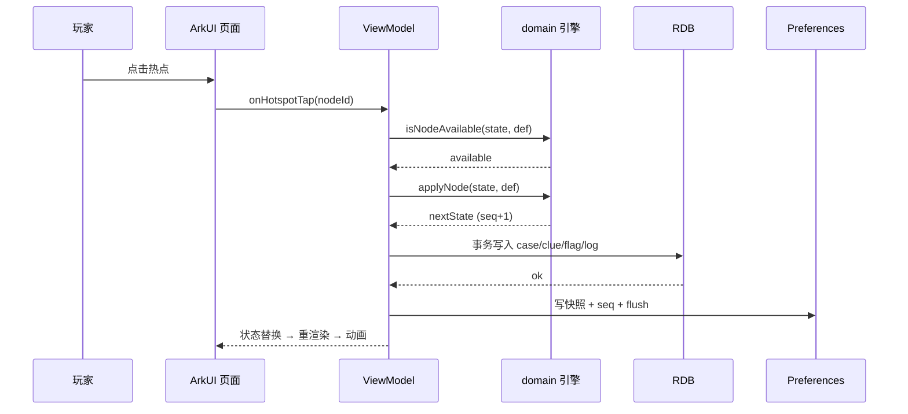

# 校园线索推理与多结局探索 App
## 基础功能需求规格说明（SRS-Base v1.4）

| 项 | 内容 |
| --- | --- |
| 项目代号 | `campus-case` |
| 文档版本 | v1.6 / 2026-11-17（修订记录见 §13） |
| 变更管理 | 每次修改完成后必须 commit + push，规则见 [README §2](../README.md) |
| 文档定位 | **只定义软件基础功能**：与具体剧情、人物、线索文本书写无关。任何一桩案子（换一份内容 JSON）都应能跑通本文全部需求 |
| 内容出处 | 剧情与关卡内容见 [内容与剧情设计规范](02-内容与剧情设计规范.md)（当前为骨架，待定稿） |
| 目标平台 | **HarmonyOS NEXT**（ArkTS + ArkUI，API 12+，单 HAP，纯离线）。本文档只描述平台无关的功能需求；编译与单测的落地步骤见 [编译与单测检查单](03-编译与单测检查单.md) |
| 形态 | 纯离线单机；竖屏手机优先，平板/折叠屏自适应（P1） |
| 技术要点 | 声明式状态管理、组件动画、领域数据建模、KV + 关系型双存储、单元测试（Hypium） |
| 不做 | AI 生成剧情、在线服务器、账号体系、网络权限、外部素材下载 |

---

## 1. 系统定位与功能边界

### 1.1 定位

一个**内容驱动的单机推理叙事引擎外壳**：引擎负责"场景—事件—线索—验证—判断—结局—存档"这条通用链路，内容负责"具体是哪桩案子"。两级分工写死，引擎里不允许出现任何具体剧情字符串。

### 1.2 角色

| 角色 | 描述 | 系统为他提供 |
| --- | --- | --- |
| 玩家 | 调查者，通过探索与推理推进 | 全部交互功能 |
| 内容编辑（开发者本人） | 只改 JSON 就能换案/加节点 | 内容 schema、校验器、错误定位（FR-16） |
| 验收方 | 检查功能是否真实生效 | HUD、收集册、存档页、测试报告 |

### 1.3 术语

| 术语 | 定义 |
| --- | --- |
| 场景 Scene | 一个可进入的空间，包含若干热点 |
| 热点 Hotspot | 场景内可点击的区域，绑定了某个事件节点 |
| 事件节点 EventNode | 一次有状态后果的交互（给线索 / 置标记 / 解锁 / 关闭其他节点 / 推进阶段） |
| 线索 Clue | 玩家可查阅的证据条目，只由事件节点产出 |
| 证据链 Chain | 一组线索 + 组合规则的集合，代表一条完整推理路线 |
| 门控 Gate | 判断"这个节点/热点/选项对当前玩家是否可见可用"的求值逻辑 |
| flag | 布尔或短字符串状态标记，分支与结局靠它判断 |
| 阶段 Stage | 案件的大步骤，单向推进（含两处允许的回退） |
| 快照 Snapshot | 玩家进度的可序列化全量状态，用于存档与快速恢复 |
| 事件流水 EventLog | 按 `seq` 递增的已发生节点记录，是恢复时的最终依据 |

### 1.4 功能边界

**包含**：启动与继续、案件接取、场景探索、事件与对话、线索获取与线索板、组合校验、推理关卡、最终判断、结局、HUD、阶段进度、存档读档重开、进程恢复、设置、内容加载与校验。

**不包含（预留接口，本期不实现）**：多案件切换 UI、云存档、成就、排行榜、内容编辑器 GUI、语音播报。

---

## 2. 功能架构总览

### 2.1 功能地图

```
启动层   FR-01 启动/继续/新局
案件层   FR-02 简报与接案
探索层   FR-03 场景与热点 · FR-05 对话 · FR-06 线索获取
引擎层   FR-04 事件节点引擎（门控/效果/互斥） · FR-16 内容加载与校验
推理层   FR-07 线索板 · FR-08 推理验证 · FR-09 最终判断
呈现层   FR-10 结局与收集册 · FR-11 HUD · FR-12 阶段进度
持久层   FR-13 存档 · FR-14 进程恢复 · FR-15 设置
支撑     FR-17 错误处理与日志
```

### 2.2 需求总表

| ID | 功能 | 优先级 | 主要页面 | 一句话验收 |
| --- | --- | --- | --- | --- |
| FR-01 | 启动、继续、新局 | P0 | Launch | 冷启动 3 条入口语义清晰且互不串味 |
| FR-02 | 案件简报与接案 | P0 | Brief | 接案写入初始状态并解锁首个场景 |
| FR-03 | 场景探索与热点 | P0 | Hub / SceneRoom | 热点四态正确，首次进入后状态不回退 |
| FR-04 | 事件节点引擎 | P0 | 全局 | 门控 + 原子效果 + 互斥关闭全部生效 |
| FR-05 | 对话系统 | P0 | SceneRoom | 选项副作用写入状态，打字机可跳过 |
| FR-06 | 线索获取与查阅 | P0 | SceneRoom / ClueBoard | 每条线索可追溯到产出节点 |
| FR-07 | 线索板与连线 | P0 | ClueBoard | 连对产结论、连错不惩罚、连线可恢复 |
| FR-08 | 推理验证 | P0 | Deduction | 通过才置标记，失败可重试 |
| FR-09 | 证据链与最终判断 | P0 | Judge | 选项可见性由链决定，伪造被拦截 |
| FR-10 | 结局与收集册 | P0 | Ending | 多结局互斥，分别可点亮 |
| FR-11 | 关键状态提示 HUD | P0 | 全局常驻 | 8 个元素随状态实时更新 |
| FR-12 | 阶段进度 | P0 | 全局常驻 | 进度单调、边界钳制、推进有反馈 |
| FR-13 | 存档 / 读档 / 重开 | P0 | Slots | 自动 + 3 手动，读档即那一刻 |
| FR-14 | 进程恢复 | P0 | Launch | 杀进程后状态 100% 一致 |
| FR-15 | 设置 | P1 | Settings | 字号/音效持久，清档需二次确认 |
| FR-16 | 内容加载与校验 | P0 | 启动期 | 引用缺失报错不崩，可降级 |
| FR-17 | 错误处理与日志 | P0 | 全局 | 每类错误有可读提示与错误码 |

---

## 2.3 模块划分与协作接口

> 这一节是「需求 → 实现」的接缝：谁负责什么、通过什么接口说话。
> 单人项目里它是自检清单；组队项目里它就是并行开发的契约（接口先定，之后各自实现）。

### 2.3.1 模块与依赖方向

| 模块 | 目录 | 职责 | 对外接口 | 允许依赖 |
| --- | --- | --- | --- | --- |
| 内容层 | `shared/case` + `harmony/.../rawfile/case` | 唯一剧情源：场景 / 节点 / 线索 / 规则 / 链 / 关卡 / 结局 | 只读 JSON（schema 见 `shared/case/case.schema.json`） | 无 |
| 领域层 | `harmony/entry/src/main/ets/domain/` | 纯函数判定：门控、效果、连线、验证、结局、进度、回放、内容校验 | `Engine` / `CaseLoader` 静态方法（见 2.3.2） | 只依赖 `Types` |
| 状态与持久层 | `harmony/entry/src/main/ets/store/` | 状态持有、落盘时序、恢复、存档槽、设置 | `GameController` / `Prefs` / `CaseDb`（见 2.3.3） | 领域层 + 系统 API |
| 视图层 | `harmony/entry/src/main/ets/view/` + `pages/Index.ets` | 渲染与交互，只读状态、只发动作 | `@Prop` 入参 + 回调 | 只依赖 `GameController` 的只读方法与动作方法 |
| 工具链 | `tools/` | 内容校验、预检、编译、演示流水线、图标 | 命令行脚本 | 无（独立于应用） |

**三条解耦硬规则**（`preflight.py` 会做静态检查）：

1. 领域层不 import 视图层或持久层；视图层不直接调 `Engine`（必须经 `GameController`，保证落盘时序）。
2. 任何一层都不允许出现具体剧情字符串（线索名、节点标题、结局名只能来自内容 JSON）。
3. 内容副本只能由 `tools/sync-case.ps1` 产生，禁止手改 `rawfile/case/`。

### 2.3.2 领域层接口（`domain/Engine.ets`，全部为无副作用静态方法）

```ts
static initialState(caseFile: CaseFile): PlayerState
static isSceneAvailable(state: PlayerState, scene: SceneDef): boolean
static nodeState(state: PlayerState, caseFile: CaseFile, nodeId: string): NodeState   // LOCKED/AVAILABLE/DONE/CLOSED
static isNodeAvailable(state: PlayerState, caseFile: CaseFile, nodeId: string): boolean
static applyNode(state: PlayerState, caseFile: CaseFile, nodeId: string): ApplyOutcome // {ok, state, noop, error}
static checkCombine(state: PlayerState, caseFile: CaseFile, a: string, b: string): CombineOutcome
static applyCombine(state: PlayerState, caseFile: CaseFile, a: string, b: string): PlayerState
static choiceAvailability(state: PlayerState, caseFile: CaseFile): Map<string, boolean>
static enterJudge(state: PlayerState): ApplyOutcome
static submitFinalChoice(state: PlayerState, caseFile: CaseFile, choiceId: string): ApplyOutcome
static resolveEnding(state: PlayerState, caseFile: CaseFile): EndingOutcome // {ready, canPublic, canPrivate, endingId}
static finishCase(state: PlayerState, caseFile: CaseFile): ApplyOutcome
static computeProgress(state: PlayerState, caseFile: CaseFile): number
static nextObjective(state: PlayerState, caseFile: CaseFile): string
static replay(caseFile: CaseFile, log: LogEntry[], base?: PlayerState): PlayerState
static canTransit(from: Stage, to: Stage): boolean
```

`CaseLoader`：`parse(text)`（JSON → `CaseFile`）与 `validate(caseFile): string[]`（空数组 = 通过，失败收集全部错误而不是 fail-fast）。

### 2.3.3 状态与持久层接口（`store/GameController.ets`）

| 类别 | 方法 | 说明 |
| --- | --- | --- |
| 生命周期 | `init(context)` / `restart()` | 启动恢复（自动槽 → 快照 → 回放）；重开本局 |
| 只读查询 | `progress()` `objective()` `stageLabel()` `clueCount()` `clueTotal()` `chainProgress(id)` `chainSize(id)` `anyChainReady()` `endingOutcome()` `requireCase()` | 视图层只能从这些方法取展示数据 |
| 动作 | `applyNode(id)` `linkClues(a,b)` `submitProof(stageId, picked)` `enterJudge()` `chooseFinal(id)` `finish()` | 每个动作内部按「判定 → 落盘 → 返回」的顺序执行，返回 `ApplyOutcome`/布尔 |
| 存档 | `saveSlot(slotId, name)` `autoSave()` `listSlots()` `loadSlot(slotId)` `deleteSlot(slotId)` | 自动槽 + 3 手动槽；读档为整体替换 |
| 设置 | `setReduceMotion(v)` | 动画减弱开关（字号缩放走 `Prefs`） |

`Prefs`：`init(context)`、`putString/getString`、`putNumber/getNumber`、`putBoolean/getBoolean`、`clearProgress()`。
`CaseDb`：五张表（案件、事件流水、存档槽、结局收集、设置），按 `seq` 对账，供恢复与收集册使用。

### 2.3.4 接口变更流程

改接口 = 改本文档 + 改调用方 + 跑回归（`preflight` / `validate` / Hypium 22 条 / `e2e.ps1`），四件事同一次提交完成。
`preflight.py` 的「ArkTS 符号」与「ArkTS 导入」两项会拦住"调用了不存在的接口"和"导入了未导出的名字"。

---

## 2.4 分工与协作方式

### 2.4.1 本项目为独立完成

| 项 | 情况 |
| --- | --- |
| 成员 | 1 人（GitHub 账号 `NaCl1Yan`） |
| 分工 | 需求、内容、领域引擎、持久化、UI/HUD/动画、单测、文档、脚本全部由本人承担 |
| 协作证据 | `git log --format='%h %an %ae %s'` 全部提交均为该账号；无他人提交记录 |
| 集成方式 | 单人顺序集成：领域层 → 持久层 → 视图层 → 演示流水线，每步以编译 + 单测 + E2E 作为集成门槛 |

> 独立学生按作业要求提交「本人承担的整体设计与集成结果」：即本仓库的完整工程 + 文档 + 测试证据。

### 2.4.2 若扩展为组队（模板，供参考）

| 模块 | 负责人 | 交付接口 | 集成点 |
| --- | --- | --- | --- |
| 内容与校验 | 成员 A | `shared/case/*.json` 通过 `validate.py` | 内容哈希进 rawfile |
| 领域引擎 | 成员 B | 2.3.2 的 `Engine` 静态方法 | `GameController.applyNode` |
| 持久化与恢复 | 成员 C | 2.3.3 的存档/恢复方法 | `init()` 恢复链 |
| UI 与动画 | 成员 D | 视图组件 `@Prop` 契约 | `pages/Index.ets` 路由 |
| 测试与演示 | 成员 E | Hypium 用例 + `e2e.ps1` 断言 | CI 式回归 |

协作规则：接口先定（本文档 2.3）→ 各自在自己分支实现 → 由集成者按「编译 + 单测 + E2E 全绿」合并；每个人的提交必须是本人 GitHub 账号。

---

## 3. 通用规则（所有功能共用，先立规矩）

### 3.1 内容与代码分离

1. 引擎代码内**不得出现**任何线索名、人物名、剧情句子；这些只能来自内容文件。
2. 内容文件首次随包打进 `resources/rawfile/case/`；运行时只读。
3. 内容规模由数据决定，界面显示 `x / N` 而非硬编码数字。

### 3.2 单一判定出口

| 判定 | 唯一实现位置 | 禁止 |
| --- | --- | --- |
| 节点是否可用 | `domain/gate.ts :: isNodeAvailable()` | 页面里写 `if (hasC1 && hasC2)` |
| 效果如何应用 | `domain/apply.ts :: applyNode()` | 各页面各自改 state |
| 连线是否成立 | `domain/combine.ts :: checkCombine()` | 在线索板组件内比对字符串 |
| 结局是谁 | `domain/ending.ts :: resolveEnding()` | 结局页里 if-else 拼条件 |
| 进度多少 | `domain/progress.ts :: computeProgress()` | 组件内算百分比 |

> 验收口径：业务判断若出现在 `pages/` 或 `view/` 里，判为不符合 AC-15。

### 3.3 状态变更与落盘时序

任何会改变玩家进度的操作，统一走这条链，顺序不可调整：

```
校验（前置/幂等） → 生成新状态（不可变，整体替换）
  → 事务写 RDB（t_case / t_clue_owned / t_flag / t_event_log）
  → 写 Preferences 快照 + seq
  → 通知 UI 重渲染 → 播放反馈动画
```

- RDB 失败：整体回滚，**内存状态也回退**，提示"保存失败，请重试"。
- Preferences 失败：不算失败（快照是加速层），记录日志，下次落盘自愈。
- 动画永远在落盘之后，防止"看到动画就杀进程"导致丢档。

### 3.4 幂等与不可逆清单

| 操作 | 幂等 | 不可逆 |
| --- | --- | --- |
| 拾取同一线索 | 是（第二次吞掉，不报错） | 否 |
| 重复点击已完成热点 | 是（只回放文案，不改状态） | 否 |
| 通过同一推理关卡 | 是（不再计分） | 是（flag 只置一次） |
| 应用互斥分支 | 每个分支仅一次 | **是（另一分支永久关闭）** |
| 交最终判断 | — | **是（不可撤销）** |
| 覆盖/删除存档 | — | 是（二次确认） |

### 3.5 内容规模约束（下限，可超不可少）

| 项 | 下限 | 校验方式 |
| --- | --- | --- |
| 可探索场景 | ≥ 3（且至少 1 个需条件解锁） | 加载期计数 |
| 有意义事件节点 | ≥ 12（每节点 ≥ 1 项状态效果） | 加载期计数 + 静态检查 |
| 可查阅线索 | ≥ 6 | 加载期计数 |
| 结局 | ≥ 2（条件互斥） | 加载期计数 + 条件差异检查 |
| 证据链 | ≥ 2 条（至少 1 条可被玩家选择打断） | 人工评审 + 演示 |

---

## 4. 功能需求详述

### FR-01 启动、继续、新局

**目的**：让玩家在 3 秒内知道"我在哪、能不能接着玩"。

**入口语义（互不混淆）**

| 入口 | 条件 | 行为 |
| --- | --- | --- |
| 继续上次 | 存在有效进度（`stage ∉ {PROLOGUE, FINISHED}`） | 恢复到上次落点页面 |
| 开始新案件 | 总是可用；存在进度时二次确认 | 清空当前案状态（保留历史归档，见 FR-13），进入简报 |
| 存档槽 | 总是可用 | 打开存档槽页面 |
| 结局收集册 | 至少有 1 个结局解锁 | 查看已解锁结局 |

**规则**
1. 冷启动读取顺序：Preferences 快照 → 与 RDB `seq` 对账 → 不一致则回放流水重建（FR-14）。
2. 恢复失败（内容版本不兼容 / 状态非法）时，不得白屏：进入"可继续的新局"，并保留旧进度为只读归档。
3. 启动态必须有加载反馈；主线程加载总时长目标 ≤ 1.5s。

**异常**：内容文件损坏 → 走 FR-16 降级；RDB 打开失败 → 只读模式（可玩不可存），HUD 显示"存档不可用"。

**验收**：三种入口在任何存档组合下语义唯一；"继续上次"落点与退出前页面一致（允许差一页：若退出在动画层则回落到所属主页面）。

---

### FR-02 案件简报与接案

**目的**：交代"查什么、为什么查、能查哪里"，并把游戏切到探索态。

**内容要素（由内容 JSON 提供，界面不硬编码）**：案件标题、副标题、委托说明、调查目标列表、已知时间线、提示（可选）。

**规则**
1. 简报页可随时从 HUD 再次打开（回顾用），再次打开**不重复触发**接案效果。
2. 点击"接受调查"→ 应用接案节点（FR-04）→ `stage: ACCEPT → EXPLORE`（打开简报时已进入 `ACCEPT`，见 FR-12 阶段表）→ 解锁首批场景 → 播放阶段推进动画 → 落盘。
3. 接案前，探索入口、线索板、推理工坊均为不可用态（点击给一行提示，不报错）。
4. 接案后不可"取消接案"；只有"重开"（FR-13）能回到接案前。

**验收**：接案前后 HUD/地图/线索板三处的可用性同时变化；重复进入简报不产生新流水。

---

### FR-03 场景探索与热点交互

**目的**：把"哪里能点"变成可被状态管理的东西，而不是死图。

**场景层规则**
1. 场景卡显示：名称、一句话描述、已调查热点比（`3/5`）、状态（锁定 / 可进入 / 已完成）。
2. 锁定场景显示解锁条件的方向性提示（"需要更多现场信息"级），不显示具体线索名。
3. 进入场景可重复；重复进入不重置任何状态。
4. 场景内无可用热点时，给出引导而非空画面：底部提示"这里已经查完了，换个地方" + 一键回地图。

**热点规则**
1. 坐标以场景图归一化坐标（0–1000）存储，渲染时按容器实际宽高换算，保证不同宽高比不错位。
2. 热点四态与视觉编码（形状/图标/文字三重编码，不只靠颜色）：

| 状态 | 含义 | 视觉 | 点击行为 |
| --- | --- | --- | --- |
| `AVAILABLE` | 可调查 | 脉冲圆环 + 「?」 | 触发节点 |
| `DONE` | 已调查 | 实心点 + 「已调查」 | 回放该节点文案（只读） |
| `LOCKED` | 前置不足 | 灰环 + 锁图标 | 提示缺什么（方向性） |
| `CLOSED` | 被其他选择关闭 | 划叉标记 + 「已封锁」 | 说明"因为你的哪一步" |

3. **`CLOSED` 必须可见**，不得从场景里消失——让玩家看见选择的代价（核心体验要求）。
4. 热区最小 44vp×44vp；长按显示热点名称（可访问性）。
5. 点击命中判定走容器坐标换算，缩放/旋转后仍准确。

**验收**：任意操作序列下，热点四态与 `PlayerState` 一致；恢复后四态还原；`DONE` 与 `CLOSED` 视觉可区分。

---

### FR-04 事件节点引擎

**目的**：这是整个 App 的心脏——把"点了什么"转成"世界变了什么"。

**节点定义字段**

```ts
interface EventNodeDef {
  id: string;              // 唯一，如 'N01'
  sceneId: string;
  title: string;
  body: string;            // 正文/对话引用
  unlockCond: Condition;   // 门控
  effect: Effect;          // 效果集合
  exclusiveWith: string[]; // 与谁互斥（应用本节点则关闭对方）
  repeatable: boolean;     // 默认 false
}
```

**门控求值顺序（短路，任一为假即不可用）**

```
1) 节点是否在 closedNodes 中        → 否
2) 所属场景是否 unlockedScenes 中    → 是
3) Condition 求值：
   allClues[]  全部持有
   anyClues[]  至少一条
   allFlags[]  全部为 true
   noneFlags[] 全部为 false
   minStage    阶段不低于
   closedNodes 不得命中
```

**效果应用（事务语义）**

```
Effect = { grantClues[], setFlags[], unlockScenes[], closeNodes[], stage? }
1. 逐项预检：grantClues 已持有时记为 skip（不报错）；stage 变更必须是合法转移
2. 任一项预检失败 → 整体不生效，返回错误码，状态不变
3. 全部通过 → 复制状态并整体替换（不原地改）
4. seq += 1
```

**规则**
1. **每个节点至少 1 项非空效果**（给线索/置 flag/解锁/关闭/推进阶段）。只有文案没有后果的节点，不计入"有意义节点"（对应 3.5 的下限校验）。
2. 互斥是**单向不可复活**的：A 应用后，B 进 `closedNodes`；即使之后条件被满足，B 仍不可用。
3. 非 `repeatable` 节点重复触发只回放文案，不产生新流水。
4. `stage` 只能通过节点的 effect 改变，页面不得直接改。
5. 每次成功应用写一条 `t_event_log`（`node_id, choice_id?, stage_after, created_at`）。

**异常与错误码**：`E_NODE_LOCKED`（前置不足）、`E_NODE_CLOSED`（已封锁）、`E_STATE_INVALID_TRANSITION`（非法阶段跳转）、`E_DB_WRITE`（落盘失败 → 回退内存）。

**验收**：TC-01…TC-08 全过；演示"撬锁类选择 → 永久关闭另一节点"可复现。

---

### FR-05 对话系统

**目的**：让人物说话时也能改变世界（选项带副作用），而不是纯播放。

**规则**
1. 一条对话 = 若干"台词行" + 至多 1 个"分支点"。
2. 台词行支持：说话人、表情/头像标识、文本。逐字显示（默认 25ms/字），点击任意处立即补全。
3. 分支点选项结构：`{ id, label, requires?, effect?, nextLineId? }`；`requires` 不满足时灰显并给原因。
4. 选项的 `effect` 与节点效果同源（同一套 apply 逻辑），因此"对话里选的"和"热点里点的"后果一致可测。
5. 已选过的分支再次进入时，标记"已选"并保留原选项（不隐藏，便于回顾），但不重复应用效果。
6. 离开页面必须清理打字机定时器；`onDisappear` 未清理判为缺陷。
7. 提供"跳过打字机"与"回顾最近 30 行"两个辅助功能。

**验收**：同一选项连点 3 次只生效 1 次；跳过/回顾不改变状态。

---

### FR-06 线索获取与查阅

**目的**：线索是唯一能推动推理的凭证，必须"可查、可溯、不可伪造"。

**规则**
1. 线索**只能**由事件节点/对话选项的 `effect.grantClues` 产出；UI 不得直接 `addClue`。
2. 重复拾取幂等（吞掉，不报错，不重复播放获得动画）。
3. 获得线索时：卡片自交互点飞向右下角线索角标 + 角标计数 +1 + 可选音效。
4. 线索详情字段：名称、类型（物证/证言/时间线，可由内容定义扩展）、描述、**来源**（产出节点 + 场景 + 时间戳）。
5. 线索板中未获得的线索显示占位卡（`?` + 方向性提示），不显示内容、不剧透。
6. 线索数量与进度：HUD 与线索板均显示 `x / N`，N 来自内容。
7. 线索不可丢弃、不可转让。

**验收**：每条已获线索的来源可点开并定位到产出节点；手工构造"无来源线索"应被加载期校验拒绝（FR-16）。

---

### FR-07 线索板与连线组合

**目的**：把"推理"做成玩家可操作的动作，而不是自动播放。

**规则**
1. 卡槽网格布局，卡槽数 = 线索总数；超出一屏时滚动，末尾占位卡一并滚动。
2. 选择交互：点第一张 → 选中态；点第二张 → 出现「连线」按钮；再次点已选卡 → 取消。
3. 校验（调用 `checkCombine`）返回三种结果：

| 结果 | 反馈 | 状态变化 |
| --- | --- | --- |
| 命中规则 | 曲线生长动画 + 结论卡滑入 + 显示结论文案 | 置 `rule.grantsFlag` |
| 无此规则 | 两卡抖动 ±6vp×3 + 文案"这两条没有直接关系" | 无（不扣次数、不记惩罚） |
| 未持有 | 不可选（占位卡不可选） | 无 |

4. 已成立的连线**持久保留**（Canvas 曲线层按 flag 重绘），已连过的一对再次点击只弹出既有结论，不重复动画。
5. 同一条线索不可自连；同一对线索不可重复建立第二条不同规则的连线。
6. 顶部显示证据链进度（每条链 `已成立/总数`）；某条链凑齐时按钮「去验证」由灰转亮，并伴随角标提示。
7. 线索板不阻塞探索：随时可从 HUD 打开，返回时保留滚动位置与选中态（会话内）。

**验收**：连线状态在场景切换、页面返回、杀进程重启后均正确重绘；连错 10 次不影响任何进度。

---

### FR-08 推理验证

**目的**：把"线索齐了"升级为"必须自己组合出结论"，才算过关。

**关卡定义**

```ts
interface ProveStageDef {
  id: string;
  question: string;        // 要回答的问题
  slots: number;           // 需要的线索数（本期 2）
  poolCond: Condition;     // 可选线索池的门控
  answer: string[];        // 正确线索组合（顺序无关）
  onPass: Effect;          // 通过后置 flag / 推进阶段
  hints: string[];         // 逐级提示
}
```

**规则**
1. 入口条件不满足时，关卡**灰显 + 原因**（不隐藏），让玩家知道还有关卡存在。
2. 提交正确 → 播放结论演出 → `onPass` 置 flag → 阶段推进（可选）→ 落盘 → 关卡标记「已通过」。
3. 提交错误 → 不扣分、不限次数 → 给一条提示（按 `hints` 逐次解锁，最多给完）。
4. 已通过关卡可重看结论，不可重复得分。
5. 槽位数与可选池由内容定义；本期固定 2 槽，但代码不得写死 2（循环处理）。
6. 提交时校验"选项必须来自已持有线索"，否则按未持有处理。

**验收**：通过/失败/重试/已通过四种状态互不污染；通过状态在重启后保持。

---

### FR-09 证据链与最终判断

**目的**：这是唯一产生结局的地方，必须"条件 → 选项可见性 → 不可撤销判断"三段清晰。

**规则**
1. 证据链在内容中声明：`Chain = { id, name, clueIds[], ruleFlagIds[], passFlagId }`；链成立 = 线索齐 + 规则齐 + 通过对应推理关卡。
2. 判断页只在**至少一条链成立**时开放；否则 HUD 提示"证据不足"并留在勘探/验证阶段。
3. 判断选项 `{ id, label, requiresChain }`：`requiresChain` 不成立的选项**灰显可见 + 原因**（不隐藏），因为"知道有另一条路"本身就是多结局体验的一部分。
4. 点击选项 → 二次确认弹窗（"这个判断不可撤销"）→ 写 `finalChoice` → `stage: JUDGE → ENDING` → 落盘 → 进结局页。
5. 判定唯一出口 `resolveEnding(state)`；若收到的 `finalChoice` 与可用链不匹配（例如外部伪造），返回 `blocked` 并忽略，不得出结局。
6. **提交与可见性都必须按"链就绪"判定，不能只查单个 flag**：`proofA` 为真但链内事实（如母带位置 `tapeFound`）缺失时，动机线并未成立，此时提交必须被拒。这条由 fixture `ending-07-missing-tape` 守着——只查 flag 的实现会在这一步漏判。
7. **校验顺序固定为：选项存在 → 该选项对应链就绪 → 阶段转移**。因此上面那种情况返回 `E_FINAL_MISMATCH`；`E_CHAIN_NOT_READY` 只由「进入判断页」的开放条件返回，不要混用（混用会让玩家看到"证据不足"却已经站在判断页上）。
6. 判断一旦提交不可撤销、不可读档回退到提交前（读档回到的是"进入判断页之前"的存档点，属正常设计，需在确认弹窗里说明）。

**验收**：TC-13…TC-18 全过；单链成立时另一选项必定灰显且原因正确。

---

### FR-10 结局呈现与收集册

**目的**：给多结局一个"值得收集"的落点。

**规则**
1. 结局定义：`{ id, name, requires(判定结果), segments[], collectible: true }`。
2. 结局页三段式演出：黑场（≥600ms）→ 结局名淡入放大 → 文案逐段（可点击加速）。
3. 结局页拦截返回手势/返回键：需二次确认才回主页（防误触丢失演出）。
4. 收集册：每个结局一格；已解锁显示名称 + 解锁时间 + 本局时长；未解锁显示 `???` + 方向性条件摘要（不剧透关键线索名）。
5. 结局登记写 `t_case.ending_id / finished_at`，并保证同一结局重复达成不产生重复条目。
6. 结局页提供：「收录并回主页」「再来一次（新周目）」；新周目等同 FR-01 的新案件流程。

**验收**：2 个结局可分别点亮且互不覆盖；收集册在清档后按规则处理（默认保留成就类记录，仅清进度——需在设置里写明）。

---

### FR-11 关键状态提示 HUD（常驻）

**目的**：玩家任何时刻都知道"我在第几阶段、下一步该干什么、还缺什么"。

| # | 元素 | 内容 | 数据来源 | 点击行为 |
| --- | --- | --- | --- | --- |
| 1 | 阶段徽标 | `第2阶段 · 勘探` | `state.stage` | 弹阶段说明 |
| 2 | 当前目标 | 一句话，动态生成 | `nextObjective(state)` | 跳转对应页面 |
| 3 | 线索计数 | `3 / 6` | `ownedClues.size` | 开线索板 |
| 4 | 证据链进度 | 每链 `●●○` | 链声明 + 已获线索/flag | 长按看方向性提示 |
| 5 | 可推理角标 | 红点 + 呼吸动画 | 任一关卡可提交 | 进推理工坊 |
| 6 | 存档指示 | `已保存 21:47` | 最近一次落盘 | 开存档槽 |
| 7 | 进度环 | 0–100% 环形 | `computeProgress` | 弹进度明细 |
| 8 | 菜单 | 简报回顾/设置/返回地图 | 路由 | 相应页面 |

**规则**
1. 状态变更到 HUD 更新不超过 1 帧（同一次渲染批次完成）。
2. HUD 固定高度，不遮挡热点；场景内滚动时 HUD 吸附顶部。
3. 元素 2 的目标文案必须能从 state 推出，且"无目标可推进"时给出终局引导（去判断 / 证据不足）。
4. 所有可点元素有 ≥44vp 热区，且提供无障碍描述（读屏可念出"线索 3 比 6"）。

**验收**：构造 6 种状态（接案前/勘探无线索/勘探半满/链齐/判断/结局），逐个核对 HUD 8 元素正确。

---

### FR-12 阶段进度与推进

**阶段枚举与合法转移**

| 值 | 阶段 | 进入方式 | 允许去向 |
| --- | --- | --- | --- |
| 0 | `PROLOGUE` | 冷启动且无进度 | `ACCEPT` |
| 1 | `ACCEPT` | 打开案件简报（UI 动作，不是节点） | `EXPLORE` |
| 2 | `EXPLORE` | 接案节点（效果 `stage=EXPLORE`） | `EXPLORE`、`DEDUCE` |
| 3 | `DEDUCE` | 进入推理工坊（节点/关卡 effect） | `EXPLORE`（补线索，允许）、`JUDGE` |
| 4 | `JUDGE` | 任一条证据链成立后进判断页 | `DEDUCE`（证据不足回退，允许）、`ENDING` |
| 5 | `ENDING` | 提交最终判断（不可撤销） | `FINISHED` |
| 6 | `FINISHED` | 结局登记 | — |

> **注意**：`PROLOGUE → EXPLORE` **不是**合法直线转移。打开简报只到 `ACCEPT`，必须由接案节点的 effect 推进到 `EXPLORE`。这条约束由 fixture `apply-03-stage-transit` 守着，别在实现里"图省事"跳级。

**规则**
1. 除表中两个回退边外，任何其他变更返回 `E_STATE_INVALID_TRANSITION`，且不改状态、不弹崩溃。
2. 进度公式（权重可配置，出厂值）：

```
PROLOGUE/ACCEPT      → 0 / 5
EXPLORE              → clamp(10 + 45 × 线索持有率, 10, 55)
DEDUCE               → clamp(55 + 15 × 已通过关卡数, 55, 85)
JUDGE                → 85
ENDING               → 95
FINISHED             → 100
```

3. 同阶段内进度必须随线索增加单调不减；越界一律 `clamp`。
4. 阶段推进时播放一次性动画（遮罩溶解 + 徽标落下），并记 `flag.stageFx.<stage>` 防重播。
5. 进度不得用于解锁（解锁只看门控），避免"刷进度"绕过设计。

**验收**：TC-07/TC-08/TC-19/TC-20；六个阶段各截一张 HUD 图核对进度值。

---

### FR-13 存档 / 读档 / 重开

**槽位设计**

| 槽 | 说明 | 写入时机 |
| --- | --- | --- |
| `slot_id = 0` | 自动槽 | 每次节点/连线/关卡/判断成功落盘时同步刷新（单槽循环覆盖） |
| `slot_id = 1..3` | 手动槽 | 玩家显式存档 |

**规则**
1. 存档内容 = 快照（全量进度）+ `seq` + 元信息（槽名、时间、阶段、线索数、进度百分比）。
2. 存档槽列表展示：槽号、槽名（默认"阶段名 + 时间"）、时间、阶段、线索数；空槽显示「空」。
3. 覆盖已占用槽 → 二次确认；删除 → 二次确认；删除后槽位回到空态。
4. **读档 = 整体替换**，不与当前状态合并：先清当前案的 `t_clue_owned` / `t_flag` / `t_event_log`，再按快照重写，保证"读档即回到那一刻"。
5. 空状态（`PROLOGUE`）不允许手动存档；已完结（`FINISHED`）允许存档（用于收集册回顾）。
6. 读档后 `seq` 重新从快照值继续递增，且新写入的流水不得与旧流水序号冲突（删除旧流水或使用独立自增，二者择一，需在实现中固定）。
7. **重开**：清空当前案进度（线索、flag、节点状态、流水）；成就/收集册记录默认保留；入口需二次确认并说明"收集册会保留"。
8. 存档写入失败要有明确提示，且不得让 UI 显示"已保存"。

**验收**：空槽/满槽/覆盖/删除/读档/重开组合 8 个用例；读档后 HUD、地图、线索板、判断页四处状态与快照一致。

---

### FR-14 进程恢复（杀进程场景）

**目的**：**不依赖任何生命周期收尾**也能恢复。这是本 App 最容易被做假的一条，必须按下面顺序实现。

**事实前提**：进程被系统杀死或用户划掉后台时，`onDestroy`/`aboutToDisappear` 可能不执行。因此"退出时保存"是错误的实现方式。

**恢复流程（冷启动）**

```
1. 初始化 Preferences（读 schema/content 版本）
2. 初始化 RDB（建表 / 迁移）
3. 加载并校验内容（FR-16）
4. 对账：
     snap  = Preferences 快照
     dbSeq = SELECT MAX(seq) FROM t_event_log WHERE case_id = ?
     if (snap 存在 && snap.seq == dbSeq)  → state = decode(snap)      // 快路径
     else                                  → state = replay(dbSeq)    // 流水回放（慢路径，兜底）
5. sanitize(state)：修正非法组合
     · stage=DEDUCE 但无线索 → 降 EXPLORE
     · ending_id 有值但 final_choice 为空 → 清 ending_id
     · 未知 clue_id / 未知 flag → 移入归档并记日志
6. 回写快照与 seq（让两侧再次一致）
7. 按 stage 决定落点页面
```

**规则**
1. 恢复必须"要么完整、要么明确降级"，禁止半恢复（例如阶段是 DEDUCE 但线索丢了）。
2. 兜底重建（流水回放）必须幂等：重复 `seq` 只生效一次。
3. 恢复耗时目标 ≤ 300ms（不含内容解析）。
4. 恢复过程写入一条 `__resume__` 流水（可选，仅用于演示与统计，不计入玩法）。
5. 内容版本升级后恢复，未知线索按 8.7 的迁移规则处理，不得崩溃。

**验收**：按 10.4 的 6 条手工脚本执行，全部一致。

---

### FR-15 设置

| 项 | 类型 | 默认 | 生效范围 | 存储 |
| --- | --- | --- | --- | --- |
| 外观（深浅色） | 跟随系统 / 浅色 / 深色 | 跟随系统 | 全局配色（资源 `base` / `dark` 双份色板） | Preferences + `setColorMode` |
| 字号缩放 | 1.0 / 1.2 / 1.5 | 1.0 | 全局文本 | Preferences |
| 音效开关 | 布尔 | 开 | 获得/连线/错误反馈音 | Preferences |
| 动画减弱 | 布尔 | 关 | 关掉位移/抖动，仅保留淡入 | Preferences |
| 存档管理 | 入口 | — | 跳存档槽页 | — |
| 清除进度 | 危险操作 | — | 二次确认 + 明示保留内容 | — |
| 关于 | 版本/构建号/内容版本 | — | 只读 | — |

**规则**：设置改动立即生效并持久；不得因设置项写入失败而阻塞玩法（失败仅提示）。
深浅色不得硬编码在组件里：所有颜色取自 `resources/base|dark/element/color.json` 的语义色（页面/卡片/边框/文本/品牌/危险/成功/氛围色），
Canvas 这类只接受字符串的绘制点用 `resourceManager.getColorSync` 解析同一份资源，保证换主题后重绘也一致。

---

### FR-16 内容加载与校验

**目的**：换内容不改代码，且错内容不能把 App 弄崩。

**加载流程**

```
CaseLoader.load(context)
  1. 读取 rawfile/case/<caseId>.json
  2. 解析为强类型对象（手写映射，ArkTS 无 any，逐字段带默认值）
  3. 校验（见下）→ 有错则收集全部错误，一次性抛出，不 fail-fast
  4. 通过 → 交给引擎
```

**校验清单（每条都要有测试）**

| # | 校验 | 不通过后果 |
| --- | --- | --- |
| 1 | `node.sceneId` 指向存在的场景 | `E_CASE_LOAD_INVALID` |
| 2 | `rule.inputs` 指向存在的线索 | 同上 |
| 3 | `chain.clueIds / ruleFlagIds / passFlagId` 均可解析 | 同上 |
| 4 | `stage` 效果变更合法转移 | 同上 |
| 5 | 互斥关系双向一致（A 关 B，则 B 不应关 C 造成死锁） | 同上 |
| 6 | 规模下限（3.5）达标 | 同上（开发期） |
| 7 | 每条线索有至少 1 个产出节点 | 同上 |
| 8 | 至少 2 条证据链，且至少 1 条可被选择打断 | 同上（开发期） |

**降级**：校验失败 → 使用内置最小案件（1 场景 / 2 节点 / 1 线索 / 1 结局）保证 App 可启动，并在"关于"页与日志中标红提示。

**校验器可复用**：同一校验器用于单元测试（TC-26），保证测试与运行时同一套规则。

---

### FR-17 错误处理与日志

**规则**
1. 所有可预期失败返回错误码对象（不 throw 到 UI 层，不吞掉）。
2. UI 面向玩家的提示统一走 3 类文案：**缺条件（还差什么）**、**不可用（为什么）**、**保存失败（怎么办）**；不出现技术堆栈。
3. 日志分级 `debug/info/warn/error`，落盘仅在 debug 构建开启；release 只保留环形内存日志（最近 200 条）供"关于"页导出。
4. 崩溃兜底：未捕获异常 → 记录并回到 Launch，提示"上次异常退出，已恢复进度"（进度由 FR-14 保证）。

---

## 5. 功能依赖与主流程



**功能依赖（硬性）**

| 功能 | 依赖 |
| --- | --- |
| FR-03/05/06 | 依赖 FR-04 的门控与效果应用 |
| FR-07 | 依赖 FR-06（线索持有）与内容规则 |
| FR-08 | 依赖 FR-07（规则 flag）与 FR-06 |
| FR-09 | 依赖 FR-08（关卡通过 flag） |
| FR-10 | 依赖 FR-09 |
| FR-11/12 | 依赖 FR-04（状态源） |
| FR-13/14 | 依赖 FR-04 的落盘时序，反向保障所有功能 |
| FR-16 | 前置所有内容型功能 |

---

## 6. 数据需求（概要）

> 详细表结构与字段含义见[技术设计]（待补），这里只锁"要存什么、不能存什么"。

**运行态状态（唯一可变真源）**

```ts
interface PlayerState {
  caseId: string; contentVersion: number; seq: number;
  stage: Stage;
  unlockedScenes: string[];
  ownedClues: string[];
  flags: Map<string, boolean>;      // 对外以对象/数组视图暴露
  closedNodes: string[];
  appliedNodes: string[];           // 已应用过的节点（幂等的依据，TC-06）
  passedStages: string[];           // 已通过的推理关卡
  finalChoice: string | null;
  endingId: string | null;
  playMs: number;
  savedAt: number;
}
```

| 数据 | 存哪 | 为什么 |
| --- | --- | --- |
| 快照（整体进度） | Preferences（JSON 字符串）+ 存档槽表 | 冷启动快、可回滚 |
| 已获线索 / flag / 阶段 / 流水 | RDB（结构化） | 可查询、可回放、可对账 |
| 静态内容（场景/节点/线索/规则/结局） | rawfile JSON | 只读、可版本化、换案不改码 |
| 设置 | Preferences | 轻量、随存随取 |
| **不存** | `PlayerState` 不进 `PersistentStorage`；动画相位、选中态、滚动位置等纯 UI 态入库 | 避免双真源与脏数据 |

---

## 7. 非功能需求

| 类别 | 要求 | 验证 |
| --- | --- | --- |
| 性能 | 冷启动可操作 ≤1.5s；点击到反馈 ≤100ms；转场 ≤300ms；恢复 ≤300ms；掉帧 <5% | 真机 Profiler，10 次取中位 |
| 内存 | 稳态 ≤120MB；反复进出全部页面 20 次不递增 | Memory Profiler |
| 稳定性 | 无未捕获异常；DB/Preferences 失败均有降级与提示 | 故障注入 + 单测 |
| 包体 | HAP ≤20MB | 构建产物 |
| 离线 | 不申请 INTERNET 权限，无任何外部请求 | 权限清单审查 |
| 数据完整性 | 任意时刻杀进程，重进后等于最后完成节点后的状态 | FR-14 验收脚本 |
| 可访问性 | 字号缩放生效；热区 ≥44vp；不只靠颜色区分状态；读屏可读 HUD | 人工 + 无障碍扫描 |
| 可维护性 | 单函数 ≤30 行、圈复杂度 ≤8；新增 1 节点只改 JSON | 评审 |
| 本地化 | 全部文案走资源文件 | 资源审查 |

---

## 8. 交互与视觉规范（功能级，不含美术风格）

### 8.0 信息架构与操作优先级

按键位置按「每局使用频率 × 误触代价」排，不按功能名字排：

| 层级 | 动作 | 位置 | 判定依据 |
| --- | --- | --- | --- |
| P0 主导航 | 地图（调查）/ 线索板 / 推理工坊 / 判断 | 底部固定 4 个 tab；判断在证据链成立时高亮为主行动 | 核心循环每局十几次，必须一指可达 |
| P1 高频上下文 | 存档 | HUD 右上，与进度环并排 | 玩家会主动存档，但不必占底部 |
| P2 阶段性查看 | 简报 / 收集册 / 设置 | HUD 右上「⋯ 更多」触发，**面板从底部弹出**（拇指可达） | 一局只看 2–3 次，不占常驻位；面板仍落在热区 |
| P3 低频 + 危险 | 重来本局 / 清空进度 / 字号 / 动画 / 外观 | 「更多 → 重来本局」「更多 → 设置」「存档页 → 重开本局」 | 破坏性操作离主操作区越远越好，且必须有二次确认 |

**反例（本次改掉的）**：把「设置 / 重来」常驻在顶部第一行，既挤占了阶段与进度环的位置，又让危险操作用户指尖可及；同时地图被埋在返回逻辑里，回主页只能靠「‹ 返回」。

**为什么触发点在上、面板在下**：底部是拇指热区，高频动作放这里最快；低频且带破坏性的入口如果也常驻底部，会显著提高误触代价。
折中做法是「触发点放右上（少碰）+ 面板从底部滑出（好点）」，这也是 iOS 溢出菜单与 Material bottom sheet 的常见组合。


### 8.1 页面清单

| 页面 | 路由 | 必含元素 |
| --- | --- | --- |
| 启动 | `Launch` | 继续 / 新案件 / 存档槽 / 收集册 / 加载态 |
| 简报 | `Brief` | 标题、委托、目标、时间线、接受按钮 |
| 地图中枢 | `Hub` | 场景卡列表（含锁定态）、HUD |
| 场景内 | `SceneRoom` | 背景层、热点层、对话层、获得动画层、回地图 |
| 线索板 | `ClueBoard` | 卡槽网格、连线层、链进度、去验证 |
| 推理工坊 | `Deduction` | 关卡列表、槽位选择、提交、提示、结论卡 |
| 最终判断 | `Judge` | 选项（含灰显原因）、二次确认 |
| 结局 | `Ending` | 三段演出、收集册登记、返回/新周目 |
| 存档槽 | `Slots` | 自动槽 + 3 手动槽、覆盖/删除/读档 |
| 设置 | `Settings` | 字号、音效、动画减弱、清档、关于 |

路由实现：单 UIAbility + 单入口页面，用 `Navigation` + `NavPathStack` 管理栈，不在页面间用全局变量传参。

### 8.2 通用反馈原则

**提示条（toast）规则**（本次按「读得完」重定）：

| 规则 | 取值 | 说明 |
| --- | --- | --- |
| 停留时间 | `max(3.4s, min(10s, 2.2s + 字数×0.16s))` | 短提示约 3.4s，长句最长 10s；固定 2.2s 会导致长句读不完 |
| 多条并存 | 同屏最多 3 条，向上叠放 | 连续动作（拿线索 + 阶段推进 + 条件不足）不再互相覆盖 |
| 手动关闭 | 点击任意提示即消失 | 不想等时可以自己关 |
| 不挡操作 | 提示浮在底部操作栏上方，不参与布局 | 出现/消失不顶动页面 |

**分题提示**：推理工坊每道题的「提示 N/M」与提交反馈按题目各自保存，切换题目不回退、不互相覆盖。

**推理工坊布局**：两道题**可同时展开**（不是手风琴）：每题内部线索选项固定两列网格，四个选项正好两排同时可见；
每题的已选数量、提示、反馈各自独立；「收起」只收当前这一题。

**提示累积展示**：点第 2 次提示时，「提示 1/N」与「提示 2/N」**同时列出**，不是只留最后一条；
全部提示用完后面板里的「提示」按钮自动禁用。


1. **有操作必有反馈**：任何可点元素在 100ms 内给出视觉回应（按压态至少变色/缩放）。
2. **有状态必有编码**：状态不能只靠颜色（加图标或文字）。
3. **有代价必有可见性**：被关闭/不可用的东西要显示出来并说明原因，不静默隐藏。
4. **有失败必有出路**：错误提示必须包含"下一步能做什么"。

### 8.3 动画清单（P0 必做 6 类）

| 场景 | 时长 | 用途 |
| --- | --- | --- |
| 页面转场 | 300ms | 层级感，线索卡→线索板用共享元素 |
| 线索获得 | 450ms | 从交互点飞向角标 + 计数滚动 |
| 连线生长 | 320ms | 线索板 Canvas 曲线 |
| 进度环插值 | 400ms | 阶段/线索变化的锚点 |
| 失败抖动 | 240ms | 错误连线/不可用点击 |
| 阶段推进 | 500ms | 遮罩溶解 + 徽标落下，只播一次 |

约束：所有动画在 `onDisappear` 必须 `finish()`/`clearInterval`；"动画减弱"开启时位移与抖动改为淡入。

---

## 9. 验收标准

| AC | 对应 | 验收口径（可勾选） |
| --- | --- | --- |
| AC-01 | FR-03 | 场景 ≥3 且含 1 个条件解锁场景，地图态正确 |
| AC-02 | FR-04 | 节点 ≥12，每个 ≥1 项状态效果，静态检查通过 |
| AC-03 | FR-06 | 线索 ≥6，全部可查、可追溯来源 |
| AC-04 | FR-09/10 | 结局 ≥2，条件互斥，可分别点亮 |
| AC-05 | FR-04 | 存在"选择导致节点永久关闭"的可复现演示 |
| AC-06 | FR-09 | 单链成立时另一选项灰显且原因正确 |
| AC-07 | FR-07 | 卡槽 + 连线 + 持久重绘 + 链进度齐备 |
| AC-08 | FR-11 | HUD 8 元素随状态实时更新 |
| AC-09 | FR-12 | 进度单调、边界钳制、推进动画只播一次 |
| AC-10 | FR-13 | 自动 + 3 手动、覆盖/删除/读档/重开全部可用 |
| AC-11 | 全链路 | 接案→探索→验证→判断→结局一次跑通，无死路 |
| AC-12 | FR-14 | 6 条杀进程脚本全过 |
| AC-13 | 状态管理 | §7.2 装饰器（技术文档）均有使用点 |
| AC-14 | §8.3 | 6 类动画可见且无泄漏 |
| AC-15 | §3.2 | 业务判断不在 `pages/`、`view/` 中出现 |
| AC-16 | §6 | Preferences + RDB 均真实读写，冲突按 FR-14 裁决 |
| AC-17 | §10 | 单测 28 条通过，`domain/` 覆盖率达标，报告入库 |

> **关于跨端验收（历史）**：早期曾并行实现 Android 版（Kotlin + Compose），对应 AC-18～AC-20（双端判定一致 / 内容单源 / 存档互通）。
> 按需求方决定，Android 版已冻结并从 `main` 移除，代码与规格完整保留在 tag `archive/android-v1`（及分支 `archive/android`），
> 需要时可 `git checkout archive/android-v1 -- android/` 取回。当前交付对象只有鸿蒙版，AC-18 退化为「ArkTS 引擎结果与 `shared/fixtures` 期望一致」，由 Hypium 用例覆盖。

---

## 10. 测试要求

### 10.1 测试边界

只测纯逻辑与序列化：`domain/`（gate / apply / combine / ending / progress / replay）与 `data/SaveCodec`、`CaseLoader` 校验器。UI 与动画走手工验收单。

### 10.2 必测项（一票否决）

| ID | 用例 | 理由 |
| --- | --- | --- |
| TC-03 | 互斥关闭永久生效且不可复活 | 分支真实性的底线 |
| TC-06 | 重复拾取幂等 | 防"多点几次多拿线索" |
| TC-13 | 仅 B 链成立 → 只出 B 结局 | 多结局互斥 |
| TC-15 | 两链成立 → 由选择决定 | 玩家意志生效 |
| TC-18 | 伪造 finalChoice 被拦截 | 门控不可绕过 |
| TC-24 | 流水回放与顺序执行一致 | 恢复正确性的根 |
| TC-26 | 内容引用校验 | 换内容不崩 |

### 10.3 覆盖率

`domain/` 行覆盖 ≥80%、分支 ≥70%；`SaveCodec` ≥90%。报告写入 `docs/TestReport.md`。

### 10.4 杀进程回归脚本

1. 接案 → 拿 1 条线索 → `force-stop` → 冷启动 → HUD 阶段/线索数/解锁场景一致。
2. 拿到解锁场景的关键线索后杀进程 → 地图入口仍在，且对应热点可点。
3. 通过 1 个推理关卡后杀进程 → 关卡仍显示已通过、对应判断选项可见性不变。
4. 手动存档 → 玩到结局 → 读档 → 回到存档时刻（线索/阶段/锁定态全回退）。
5. 只保留 RDB（手工删 Preferences）→ 冷启动 → 由流水重建成功。
6. 只保留 Preferences（手工删 DB）→ 冷启动 → 快照兜底可用并自愈回写。

---

## 11. 里程碑

| 里程碑 | 内容 | 完成标志 |
| --- | --- | --- |
| M1 骨架 | 工程、路由、模型、HUD 静态版、内容 JSON 空壳 | 能空跑 4 个页面 |
| M2 引擎 | 门控/效果/组合/结局/进度纯函数 + 单测 | `domain/` 全绿 |
| M3 界面 | 场景/对话/线索板/验证/判断/结局 + 6 类动画 | 全流程可玩（用占位内容） |
| M4 持久化 | RDB 5 表、Preferences、存档槽、恢复、迁移 | 杀进程不丢档 |
| M5 收尾 | 覆盖率、回归、文档、演示 | 验收包 |

---

## 12. 风险与对策

| 风险 | 对策 |
| --- | --- |
| ArkTS 无 `any`、JSON 反序列化丢类型 | 手写字段映射 + 逐项校验，配 TC-26 |
| `@Observed` 只观察一层，`Map/Set` 原地改不刷新 | 状态整体替换；对外暴露数组视图 |
| 依赖 `onDestroy` 存档导致丢档 | 一律即时落盘（§3.3），FR-14 兜底 |
| 快照与 RDB 漂移 | `seq` 对账 + 流水回放裁决 |
| 结局条件写成散落 if | 只留 `resolveEnding()` 一个出口 |
| 动画定时器未清理 | 统一 `aboutToDisappear` 清理 + AC-14 |
| 内容越写越大挤压工期 | 内容与引擎解耦，先用占位内容跑通链路 |

---

## 13. 变更与提交管理

> 完整规则见 [README §2 提交规范](../README.md)。此处只列与本文档相关的硬性约束。

| 规则 | 内容 |
| --- | --- |
| 修改即提交并推送 | 任何一次修改（文档定稿 / 功能实现 / 缺陷修复）完成后必须立即 commit 并 push 到 `origin/main`，任务结束时 `git status` 必须干净 |
| 文档与代码同步 | 改动任何 FR 的判定规则、字段定义、阈值，必须同一次任务内更新本文档；代码与文档冲突时以文档为准并补齐实现 |
| 一次提交一件事 | 不允许把"改需求 + 改实现 + 调样式"塞进同一个 commit |
| 提交信息格式 | `<type>(<scope>): <中文摘要>`，type/scope 取值见 README §2.2；禁止 `update`、`修改一下` 等无信息量信息 |
| 需求变更留痕 | 提交正文注明 `Refs: FR-xx / AC-xx`，便于把验收项追溯到具体 diff |
| 版本标记 | 里程碑验收通过后打 tag：`m1-skeleton` → `m5-release`；可玩版本 `v0.1.0`，验收通过 `v1.0.0` |

**本文档的修订记录**

| 版本 | 日期 | 变更 |
| --- | --- | --- |
| v1.0 | 2026-11-16 | 从混写版拆出，重构为"软件基础功能"规格：FR-01～FR-17、通用规则、验收与测试要求；剧情内容移出至 02 与 drafts |
| v1.1 | 2026-11-16 | 新增 §13 变更与提交管理，提交规则成为项目硬性约束 |
| v1.2 | 2026-11-16 | 提交规则补"推送"要求：绑定远程 `origin`（GitHub 私有仓库）后，每次修改须 commit + push |
| v1.3 | 2026-11-16 | 目标平台扩为双端同构（HarmonyOS + Android）；本文保持平台无关，Android 落地映射与 AC-18～20 见 03 文档 |
| v1.4 | 2026-11-16 | 按引擎实现回填：阶段表补"进入方式"并明确 `PROLOGUE→EXPLORE` 非法；`PlayerState` 与快照新增 `appliedNodes`（幂等依据，TC-06） |
| v1.5 | 2026-11-16 | FR-09 明确最终判断的校验顺序与错误码归属（`E_FINAL_MISMATCH` 用于选项/链不符，`E_CHAIN_NOT_READY` 只用于判断页开放条件）；实测修正后两端一致 |
| v1.6 | 2026-11-17 | 交付范围收敛为鸿蒙版：目标平台改为 HarmonyOS NEXT 单端；AC-18～20 降级为历史说明，Android 代码与规格归档到 tag `archive/android-v1` 后从 `main` 移除 |

---

## 附录 A 枚举与常量

```ts
enum Stage { PROLOGUE, ACCEPT, EXPLORE, DEDUCE, JUDGE, ENDING, FINISHED }
enum ClueType { PHYSICAL, TESTIMONY, TIMELINE }
enum NodeState { LOCKED, AVAILABLE, DONE, CLOSED }
enum ActionResult { OK, LOCKED, CLOSED, ALREADY_DONE, PERSIST_FAILED }

const MIN_SCENES = 3;
const MIN_NODES = 12;
const MIN_CLUES = 6;
const MIN_ENDINGS = 2;
const PROVE_SLOTS = 2;
const SAVE_SLOTS_MANUAL = 3;
const SAVE_SLOT_AUTO = 0;
const HOTSPOT_MIN_VP = 44;
```

## 附录 B 错误码

| Code | 含义 | 玩家可见提示方向 |
| --- | --- | --- |
| `E_NODE_LOCKED` | 前置不足 | 还差什么 |
| `E_NODE_CLOSED` | 已被选择关闭 | 哪一步导致的 |
| `E_STATE_INVALID_TRANSITION` | 非法阶段跳转 | 内部错误，回退 UI |
| `E_CASE_LOAD_INVALID` | 内容引用不完整 | 已启用内置案例 |
| `E_DB_WRITE` | 事务失败 | 保存失败，请重试 |
| `E_SNAPSHOT_DECODE` | 快照损坏 | 静默走流水重建 |
| `E_SLOT_EMPTY` | 空槽读档 | 按钮灰显 |
| `E_CHAIN_NOT_READY` | 无链成立就进判断 | 证据不足 |
| `E_FINAL_MISMATCH` | 选择与可用链不符 | 忽略并提示 |

## 附录 C 快照字段（`v=1`，与 §6 结构一致）

```json
{
  "v": 1,
  "caseId": "case_id",
  "contentVersion": 1,
  "seq": 0,
  "stage": "EXPLORE",
  "unlockedScenes": ["S1"],
  "ownedClues": [],
  "flags": {},
  "closedNodes": [],
  "appliedNodes": [],
  "passedStages": [],
  "finalChoice": null,
  "endingId": null,
  "playMs": 0,
  "savedAt": 0
}
```

## 附录 D 需求追踪（功能 → 验收 → 测试）

| 功能 | 验收 | 测试 |
| --- | --- | --- |
| FR-02 简报接案 | AC-11 | TC-01 |
| FR-03 场景热点 | AC-01 AC-05 | TC-02 TC-03 TC-05 |
| FR-04 节点引擎 | AC-02 AC-05 | TC-03~TC-08 |
| FR-05 对话 | AC-05 | TC-06 |
| FR-06 线索 | AC-03 | TC-06 TC-26 |
| FR-07 线索板 | AC-07 | TC-09~TC-12 |
| FR-08 推理验证 | AC-11 | TC-09 TC-13 |
| FR-09 最终判断 | AC-04 AC-06 | TC-13~TC-18 |
| FR-10 结局 | AC-04 | TC-15 TC-16 |
| FR-11 HUD | AC-08 | 手工 6 态 |
| FR-12 进度 | AC-09 | TC-19 TC-20 |
| FR-13 存档 | AC-10 | TC-21~TC-23 |
| FR-14 恢复 | AC-12 | TC-24 TC-25 TC-27 |
| FR-16 内容校验 | AC-02 | TC-26 |
