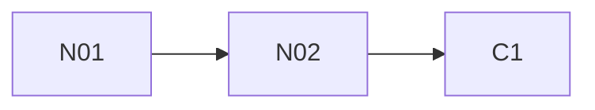

# 内容与剧情设计规范（骨架 v0.1）
## 案例内容 schema · 规模约束 · 校验规则 —— **内容正文待定**

| 项 | 内容 |
| --- | --- |
| 状态 | 🚧 骨架，仅定结构与约束，**不含具体剧情** |
| 配套文档 | [基础功能需求规格说明](01-基础功能需求规格说明.md)（引擎侧规则以此为准） |
| 变更管理 | 内容格式改动须与引擎同步提交，提交类型用 `content(<scope>)`；规则见 [README §2](../README.md) |
| 原则 | 引擎不含剧情字符串；本文件定义"内容长什么样"，具体案件文本后续单独成文 |

> 本阶段的目标：先把**内容格式**钉死，让引擎与单元测试可以脱离剧情先跑起来（用占位内容即可）。剧本、人物、线索文本、结局文案等到内容阶段再写。

---

## 1. 内容文件组织

```
entry/src/main/resources/rawfile/case/
  <caseId>/
    case.json        // 案件元信息 + 场景 + 节点 + 线索 + 规则 + 链 + 结局
    text.json        // 全部文案（可选拆出，便于校对与本地化）
    assets/          // 场景底图、图标（可选）
```

约定：
- `caseId` 只用小写字母、数字、下划线。
- 单文件优先（`case.json` 可包含 `text`）；文案量超过约 300 条时再拆 `text.json`，用 `text.<key>` 引用。
- 所有 `id` 全局唯一，推荐前缀：场景 `S`、节点 `N`、线索 `C`、规则 `R`、链 `CH`、结局 `E`。

---

## 2. 类型定义（引擎侧的契约）

> **权威来源**：从 v0.2 起，内容结构以 [shared/case/case.schema.json](../shared/case/case.schema.json) 为准（JSON Schema，可被编辑器与 CI 直接校验）。
> 下面保留类型概览便于阅读；字段若有出入，以 schema 与 `domain/Types.*` 为准。

**已落地文件**

| 文件 | 说明 |
| --- | --- |
| `shared/case/campus_001.json` | 占位案件：4 场景 / 12 节点（N04 为互斥分支）/ 6 线索 / 3 规则 / 2 证据链 / 2 关卡 / 2 结局 |
| `shared/case/case.schema.json` | 内容 schema，内含规模下限（scenes ≥3、nodes ≥12、clues ≥6…）与 condition/effect 结构 |
| `shared/fixtures/*.json` | 42 条判定用例，两端必须给出同样结果（AC-18） |

```ts
interface CaseDef {
  id: string;
  title: string;
  subtitle?: string;
  contentVersion: number;
  brief: BriefDef;
  scenes: SceneDef[];
  nodes: EventNodeDef[];
  clues: ClueDef[];
  rules: CombineRuleDef[];
  chains: ChainDef[];
  endings: EndingDef[];
  proveStages: ProveStageDef[];
}

interface BriefDef {
  client: string;          // 委托人（可匿名）
  summary: string;         // 委托说明
  objectives: string[];    // 调查目标，逐条勾选
  timeline?: TimelineItem[]; // 已知时间线（可选）
}

interface SceneDef {
  id: string;
  name: string;
  desc: string;
  bgAsset?: string;
  unlockCond: Condition;   // 空条件 = 开局解锁
  hotspots: HotspotDef[];
  enterFx?: string;        // 入场动画标识
}

interface HotspotDef {
  id: string;
  nodeId: string;
  x: number;               // 归一化 0–1000
  y: number;
  r?: number;              // 命中半径（归一化）
  shape?: 'circle' | 'rect';
  lockedHint?: string;     // 锁定态的方向性提示
}

interface EventNodeDef {
  id: string;
  sceneId: string;
  title: string;
  body: string | DialogRef;
  unlockCond: Condition;
  effect: Effect;
  exclusiveWith?: string[];
  repeatable?: boolean;
}

interface ClueDef {
  id: string;
  name: string;
  type: 'PHYSICAL' | 'TESTIMONY' | 'TIMELINE';
  desc: string;
  chainId?: string;        // 归属证据链
  hintWhenMissing?: string; // 未获得时的方向性提示（不剧透）
}

interface CombineRuleDef {
  id: string;
  inputs: [string, string];
  conclusion: string;
  grantsFlag: string;
  chainId: string;
}

interface ChainDef {
  id: string;
  name: string;
  clueIds: string[];
  ruleFlagIds: string[];
  passFlagId: string;      // 对应推理关卡通过后的 flag
}

interface ProveStageDef {
  id: string;
  question: string;
  slots: number;           // 本期固定 2
  poolCond: Condition;
  answer: string[];
  onPass: Effect;
  hints: string[];
}

interface EndingDef {
  id: string;
  name: string;
  segments: string[];      // 演出段落
  choiceId: string;        // 对应最终判断选项
  requires: Condition;     // 判定条件（阈值比 choice 更严，防伪造）
}

interface Condition {
  allClues?: string[];
  anyClues?: string[];
  allFlags?: string[];
  noneFlags?: string[];
  minStage?: string;
  closedNodes?: string[];
}

interface Effect {
  grantClues?: string[];
  setFlags?: Record<string, boolean> | [string, boolean][];
  unlockScenes?: string[];
  closeNodes?: string[];
  stage?: string;
}
```

> ArkTS 不支持 `Record` 索引签名习惯用法，实现时 `setFlags` 用 `[key, value][]` 二元组数组，解析后转 `Map`。

---

## 3. 规模约束（下限）

| 项 | 下限 | 额外要求 |
| --- | --- | --- |
| 场景 | 3 | ≥1 个需条件解锁；每场景 ≥3 个热点 |
| 有意义节点 | 12 | 每节点 ≥1 项非空 `effect` |
| 线索 | 6 | 每条 ≥1 个产出节点；每条归属一条链 |
| 规则 | 3 | 每条规则两端线索都必须可被玩家实际获得（非死线索） |
| 证据链 | 2 | 至少 1 条可被玩家选择打断（互斥关闭） |
| 推理关卡 | 2 | 每条链 ≥1 关；答案必须由线索组合唯一确定 |
| 结局 | 2 | 条件互斥（同一状态不可能同时满足） |

---

## 4. 内容级不变量（加载期校验，见 FR-16）

1. 每个 `node.sceneId` / `rule.inputs[]` / `chain.*` 引用均可解析。
2. 每条线索至少有一个节点会 `grantClues` 它；不存在"永远拿不到"的线索。
3. 每个 `effect.stage` 都是合法阶段转移。
4. 互斥关系不构成死锁：`A closes B` 时，`B` 不得是"唯一能让阶段继续推进"的节点。
5. 每个结局的 `requires` 与其余结局的 `requires` 互斥（至少有一条 flag/线索条件的差异）。
6. 每条链的 `clueIds` 与 `ruleFlagIds` 不存在冗余（不需要的线索不应列入）。
7. 至少存在一条完整路径（从接案到结局）所有门控可满足——由测试脚本穷举或人工走查确认。

---

## 5. 待填内容表（下阶段填）

### 5.1 案件元信息

| 字段 | 待定内容 |
| --- | --- |
| 案件标题 | TBD |
| 委托人与委托理由 | TBD |
| 调查目标（3–5 条） | TBD |
| 失窃/异常事件与时间锚点 | TBD |

### 5.2 场景表

| ID | 名称 | 解锁条件 | 热点数 | 承载线索 | 底图资源 |
| --- | --- | --- | --- | --- | --- |
| S1 | TBD | 开局 | TBD | TBD | TBD |
| S2 | TBD | TBD | TBD | TBD | TBD |
| S3 | TBD | TBD | TBD | TBD | TBD |
| S4 | TBD | 条件解锁 | TBD | TBD | TBD |

### 5.3 事件节点表

| ID | 名称 | 场景 | 前置 | 效果 | 互斥 | 产出线索 |
| --- | --- | --- | --- | --- | --- | --- |
| N01 | TBD | TBD | — | stage→EXPLORE | — | — |
| …（共 ≥12） | | | | | | |

### 5.4 线索表

| ID | 名称 | 类型 | 产出节点 | 归属链 | 未获得提示 |
| --- | --- | --- | --- | --- | --- |
| C1–C6 | TBD | | | | |

### 5.5 规则与证据链

| 规则 | 组合 | 结论 | 产出 flag | 链 |
| --- | --- | --- | --- | --- |
| R1–R3 | TBD | | | |

### 5.6 结局表

| ID | 名称 | 触发条件 | 对应判断选项 | 情感落点 |
| --- | --- | --- | --- | --- |
| E1 | TBD | TBD | TBD | TBD |
| E2 | TBD | TBD | TBD | TBD |

### 5.7 依赖图（待画）



---

## 6. 与引擎的对接点

| 内容字段 | 引擎消费位置 | 备注 |
| --- | --- | --- |
| `unlockCond` | `isNodeAvailable` / 场景入口 | 同一 Condition 求值器 |
| `effect` | `applyNode` | 事务语义，全成或全不成 |
| `exclusiveWith` | `applyNode` → `closedNodes` | 写入后永不复活 |
| `rules[].grantsFlag` | `checkCombine` | 线索板连线即写入 |
| `proveStages[].onPass` | 推理关卡通过 | 通常置 `passFlagId` |
| `endings[].requires` | `resolveEnding` | 唯一结局出口 |

---

## 7. 交付顺序建议

1. 先写 **case.json 骨架 + 占位内容**（每场景 1 热点、1 线索、1 结局），跑通全链路与单测。
2. 再补 **12 节点 / 6 线索 / 2 链 / 2 结局** 的真实内容。
3. 最后写文案（对话、结局演出），文案改动不影响引擎与测试。
