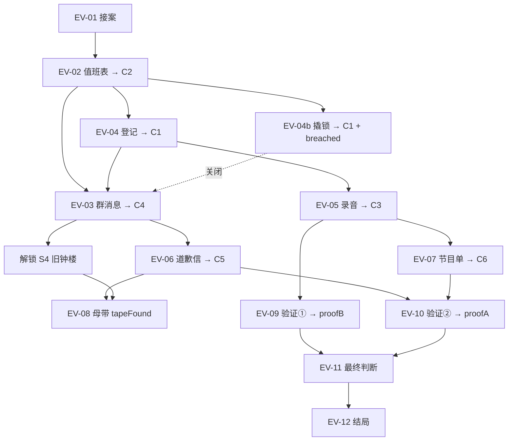
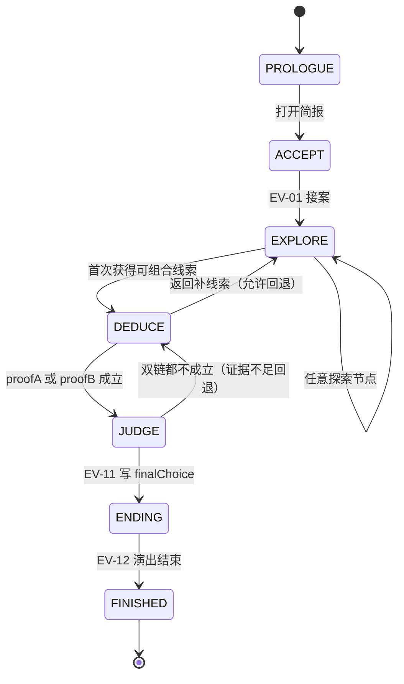

> ⚠️ **草案存档，暂不采用。**
> 本文是 v0 版，把具体剧情（案件、场景、线索、结局）与技术方案混写在一起。
> 现按当前要求拆分：软件基础功能 → `01-基础功能需求规格说明.md`；内容结构 → `02-内容与剧情设计规范.md`。
> 具体剧情内容在本阶段暂缓，本文仅作为素材保留，后续写剧本时可取用其中的桥段。
# 《钟楼七点》校园线索推理与多结局探索 App
## 需求与功能规格说明书（SRS v1.0）

| 项 | 内容 |
| --- | --- |
| 项目代号 | `campus-case`（应用名《钟楼七点》） |
| 文档版本 | v1.0 / 2026-11-16 |
| 目标平台 | HarmonyOS NEXT（ArkTS + ArkUI 声明式，API 12+，单 HAP） |
| 形态 | 纯离线单机，竖屏手机优先，平板/折叠屏自适应（P1） |
| 技术要点 | ArkUI 状态管理、组件动画、领域建模、Preferences + RDB、Hypium 单元测试 |
| 明确不做 | AI 生成剧情、在线服务器、账号体系、联网权限、配音与外部素材下载 |

---

## 1. 项目概述

### 1.1 一句话定义

玩家扮演推理社新生，在校庆前夜调查广播母带失窃案：探索 3 个以上场景、收集 6 条线索、在 12 个事件节点上做有代价的选择，通过线索组合验证两条互斥证据链，最终走向两个条件不同的结局——中途杀进程也不会丢进度。

### 1.2 要解决的核心问题

市面上的"点击式剧情 App"普遍是**假分支**：选项只换一段文本，后续事件、可用场景、结局判定都不变，玩家第一次就摸到全部内容，没有重开动机。本项目要证明的是：

> 线索与选择必须写入状态，状态必须改变"下一批节点是否可见、是否可拾取、最终判定走哪条链"。

因此本项目把"分支"实现为**数据驱动的依赖门（Gate）**，而不是文本跳转。

### 1.3 体验目标

| 指标 | 目标 |
| --- | --- |
| 单周目时长 | 8–12 分钟 |
| 一周目必得结局 | 2 个之一，且**只能**走通一条证据链的情况下强制另一个 |
| 全收集所需周目 | 2 周目（因互斥分支） |
| 中途退出恢复 | 杀进程后冷启动，恢复到最近一次事件完成后的状态，100% 一致 |
| 学习曲线 | 无教程也能在 1 分钟内明白"去哪、拿什么、去哪验证" |

### 1.4 关键设计取舍（先看这里，避免后面返工）

1. **内容与进度分离**：静态剧本（场景/节点/线索/规则/结局文案）放 `rawfile/case/*.json`；运行时进度只存增量（已获线索、flag、阶段、事件流水）。换案件 = 换 JSON，不动代码。
2. **双真源 + 单一裁决**：RDB 存结构化的"事实"（线索、flag、事件流水 `seq`），Preferences 存"最后一次快照"（快速冷启动）。冲突时**以 RDB 事件流水回放结果为准**，Preferences 只做加速。
3. **引擎纯函数化**：所有"能不能做/能不能拿/结局是谁"的判断都在 `domain/` 层的纯函数里，不碰 UI、不碰数据库 → 可直接单测，覆盖率要求只针对这一层。
4. **关键写入不防抖**：进程被杀时 `onDestroy` 可能不执行，所以每个节点生效后**立即事务落盘**，绝不攒批。

---

## 2. 需求分析

### 2.1 用户画像

| 画像 | 描述 | 对应需求 |
| --- | --- | --- |
| 主线用户：课间玩家 | 大学生，碎片时间 5–10 分钟，玩完一局就关 | 单周目短、随时可退可回、自动存档 |
| 收集型玩家 | 想看完两个结局和全部线索 | 互斥分支、结局收集册、线索板空缺提示 |
| 剧情型玩家 | 关心人物，讨厌被"游戏化惩罚" | 结局有情感落点，不靠失败/重试驱动 |
| 评委/验收方 | 检查是否真的实现了状态管理、持久化、测试 | 可演示的进程恢复、可视化 HUD、测试报告 |

### 2.2 使用场景（Scenario）

- **S1 碎片体验**：课间 6 分钟，从接案一路走到"证据不足，先去补线索"，直接退出；下节课间冷启动，HUD 仍在"勘探 · 行动线 2/3"，不用重走对话。
- **S2 二周目**：第一次撬了器材室锁，得到 C1 但学生会办公室的门被锁（EV-03 永久关闭），只能走"追责"结局；重开后选择登记借用，拿到 C4，解锁旧钟楼与"和解"结局。
- **S3 演示/答辩**：结束后台进程 → 冷启动 → 进度完整；打开存档槽页面回滚到验证阶段前，重放另一种最终判断。

### 2.3 用户故事（含验收要点）

| ID | 用户故事 | 验收要点 |
| --- | --- | --- |
| US-01 | 作为玩家，我要在开局看到案件简报和"接受调查"入口，明确我要干什么 | 简报含委托人、失窃物、时间线、目标；接受后 HUD 出现第一个目标 |
| US-02 | 作为玩家，我要能在地图上选场景进入并点击热点调查 | 每个场景 ≥ 3 个热点，热点有可点/已探索/锁定三态 |
| US-03 | 作为玩家，我要在拿到线索时有明确反馈，并能随时打开线索板 | 获得动画 + 线索板角标 +1；线索板可看详情与关联 |
| US-04 | 作为玩家，我要能自己把两条线索连起来验证推理 | 连线有对/错反馈；正确连线点亮对应推理节点 |
| US-05 | 作为玩家，我要知道现在缺什么，而不是乱逛 | HUD 明确显示两条证据链各自 `x/3` 与缺失项提示（不直接剧透答案，只给方向） |
| US-06 | 作为玩家，我的选择要真的影响后面 | 选择写入 flag；被关闭的节点在场景里显示"已封锁"而非消失（让玩家意识到代价） |
| US-07 | 作为玩家，我要两个条件不同的结局 | 最终判断的选项可见性由证据链决定；不同链 → 不同结局页 |
| US-08 | 作为玩家，我中途退出不能丢进度，也要能主动存档/读档/重开 | 冷启动恢复一致；3 个手动槽 + 1 个自动槽；重开二次确认 |

### 2.4 竞品参考与差异化

| 参考 | 借鉴 | 差异化 |
| --- | --- | --- |
| 《逆转裁判》 | 证据→证言的"对质"张力 | 本项目用"线索两两连线 + 规则校验"替代法庭演出，成本低、可单测 |
| 《Her Story》 | 关键词驱动检索 | 本项目改为"证据链门槛"驱动，进度感更强 |
| 《未定事件簿》等 | 线索板 UI 心智 | 本项目线索板是**可操作**的推理面板，不是收藏册 |

### 2.5 目标 / 非目标

**目标（本期必做）**
- 3 个以上可探索场景（实际 4 个，含 1 个需解锁）
- 12 个有意义的事件节点（含 1 个互斥分支变体）
- 6 条可查阅线索，全部带获取条件
- 2 个由**不同条件**触发的结局
- 线索板、关键状态提示（HUD）、阶段进度
- 存档（3 手动 + 1 自动）、读档、重开
- 杀进程后冷启动恢复
- Preferences + RDB 双持久化、Hypium 领域单测

**非目标（本期不做，接口预留）**
- AI 生成剧情 / LLM 接入
- 联机、云存档、账号
- 语音配音、背景音乐文件分发（用系统音效或静音占位）
- 多案件并行（数据层已按 `case_id` 预留）
- 成就系统、排行榜

### 2.6 硬约束

| 约束 | 内容 |
| --- | --- |
| 语言/框架 | ArkTS，禁止 `any`、禁止动态属性访问；状态管理以 `@State/@Prop/@Link/@Provide/@Consume/@Observed/@ObjectLink` 为主 |
| 权限 | 不申请 `ohos.permission.INTERNET`；仅本应用沙箱读写 |
| 数据 | RDB `StoreConfig.securityLevel = S1`；Preferences 名 `campus_case_pref` |
| 兼容 | API 12+；竖屏 360–430vp 宽为基准，折叠屏展开态走双栏（P1） |
| 体积 | HAP ≤ 20MB，冷启动首帧 ≤ 1.5s |

---

## 3. 功能范围总览

| 需求 ID | 功能模块 | 优先级 | 说明 |
| --- | --- | --- | --- |
| FR-01 | 案件简报与接案 | P0 | 进入案件、写入初始状态、解锁首个场景 |
| FR-02 | 场景探索（热点交互） | P0 | 4 个场景，热点三态，交互改变状态 |
| FR-03 | 事件节点引擎 | P0 | 12 节点按门控可见/可触发，效果原子应用 |
| FR-04 | 线索收集与线索板 | P0 | 6 线索，卡片详情、连线组合、空缺提示 |
| FR-05 | 人物对话 | P0 | 分支对话，选项携带 flag 副作用 |
| FR-06 | 推理验证（组合校验） | P0 | 3 条组合规则 + 2 道验证关卡 |
| FR-07 | 最终判断与结局判定 | P0 | 选项可见性由证据链决定，2 结局互斥 |
| FR-08 | 关键状态提示 HUD | P0 | 阶段、目标、线索计数、双链进度、存档指示 |
| FR-09 | 阶段进度 | P0 | 进度环 + 阶段名 + 阶段解锁动画 |
| FR-10 | 存档 / 读档 / 重开 | P0 | 自动槽 + 3 手动槽，快照 + 事件流水 |
| FR-11 | 进程恢复 | P0 | 冷启动恢复，含 RDB 回放兜底 |
| FR-12 | 动画与交互反馈 | P0 | 转场、获得、连线、抖动、结局演出 |
| FR-13 | 设置 | P1 | 字号缩放 1.0/1.2/1.5、音效开关、清档 |
| FR-14 | 结局收集册 | P1 | 显示 A/B 已解锁与触发条件摘要 |
| FR-15 | 行动点（探索次数预算） | P1 | 开启后单周目无法全收集，强化重开动机（默认关） |

---

## 4. 案件内容设计（可直接照着实现）

### 4.1 案情梗概

> 校庆前夜 21:40，学生会广播站为校庆准备的唯一成品母带《七点钟声》失窃。站长苏晚（高三）被指交接失职，面临停职。推理社接到匿名委托介入。
>
> 真相：替补播音陈墨（高一）的节目「第 7 个」在校庆节目单上被红线划掉，他把母带藏进旧钟楼老播音间，想让节目"播不成"。而苏晚写了一封没寄出的道歉信，本来是想告诉陈墨：她已申请把他加回第 7 个节目。

时间线锚点（用于推理校验，也是 C2/C3 的证据价值）：

| 时刻 | 事件 |
| --- | --- |
| 20:55 | 苏晚把母带放进广播站铁柜，登记表写 21:00 交接 |
| 21:10 | 实验楼器材室钥匙卡被取用（登记本有记录） |
| 21:30 | 广播站门禁有一次刷卡记录（登记表此处被涂改） |
| 21:40 | 值班学生发现铁柜空了，母带失踪 |
| 21:55 | 陈墨出现在旧钟楼（无人证，仅群聊截图提到） |

### 4.2 场景（S1–S4）

| ID | 场景 | 解锁条件 | 热点数 | 承载线索 | 氛围/动画要点 |
| --- | --- | --- | --- | --- | --- |
| S1 | 图书馆 · 旧报刊区 | 接案后默认解锁 | 4 | C2、C5 | 落地灯暖光、灰尘粒子 |
| S2 | 实验楼 · 器材室走廊 | 获得 C2 后解锁（EV-02） | 4 | C1 | 冷白日光灯、金属反光、门锁特写 |
| S3 | 学生会办公室 · 广播站 | 获得 C1 后解锁（EV-04/04b） | 5 | C3、C4、C6 | 铁柜、调音台推子、走廊门禁 |
| S4 | 旧钟楼 · 老播音间 | 获得 C4 后解锁（EV-03） | 3 | EV-08 的母带位置 flag | 木楼梯、钟摆、单束顶光 |

> 场景数 = 4（要求 ≥ 3）。S4 是"条件解锁场景"，用来证明线索真的改变可探索范围。

### 4.3 事件节点（12 个）

字段说明：`前置` = 门控条件；`效果` = 原子写入的状态变更；`互斥` = 该节点与谁不能共存。

| ID | 节点名 | 场景 | 前置条件 | 交互形式 | 效果 | 互斥/联动 |
| --- | --- | --- | --- | --- | --- | --- |
| EV-01 | 接受调查 | 简报页 | 无 | 按钮「接下这桩案子」 | `stage=EXPLORE`；`flag.accepted=true`；解锁 S1；写事件流水 | — |
| EV-02 | 值班表上的涂改 | S1 | `flag.accepted` | 热点：翻查登记表 | 得 **C2**；`flag.ledgerChecked=true`；解锁 S2 | — |
| EV-03 | 内部群里的删除消息 | S3 | 有 C2 且 `flag.breached=false` | 热点：翻手机/电脑 | 得 **C4**；解锁 S4 | **被 EV-04b 永久关闭** |
| EV-04 | 器材室的取用登记（稳妥） | S2 | 有 C2 | 对话（找实验员登记） | 得 **C1**；`flag.registered=true`；解锁 S3 | 与 EV-04b 二选一 |
| EV-04b | 撬开器材室（冒进） | S2 | 有 C2 | 热点：撬锁（二次确认） | 得 **C1**；`flag.breached=true`；解锁 S3 | 与 EV-04 二选一；**关闭 EV-03** |
| EV-05 | 被剪掉的录音 | S3 | 有 C1 或 C2 | 热点：听调音台缓存 | 得 **C3**；解锁推理工坊 | — |
| EV-06 | 未寄出的道歉信 | S1 | 有 C4 | 热点：自习区书页 | 得 **C5** | — |
| EV-07 | 节目单草稿 | S3 | 有 C3 | 热点：公告栏草稿 | 得 **C6**；`flag.foundDraft=true` | — |
| EV-08 | 老播音间的母带 | S4 | 已解锁 S4 且有 C5 | 热点：收音机暗格 | `flag.tapeFound=true`（不产出新线索，产出"位置证据"） | 需对话后二次进入 |
| EV-09 | 验证①：谁第二次进了广播站 | 推理页 | 有 C1+C2+C3 | 连线通过关卡 | `flag.proofB=true` | 解锁 EV-11 |
| EV-10 | 验证②：第 7 个节目与那封信 | 推理页 | 有 C4+C5+C6 | 连线通过关卡 | `flag.proofA=true` | 解锁 EV-11 |
| EV-11 | 最终判断 | 判断页 | `flag.proofA` 或 `flag.proofB` | 二选一（可见性受链约束） | 写 `finalChoice`；`stage=ENDING` | 决定 EV-12 |
| EV-12 | 结局呈现 | 结局页 | 已写 `finalChoice` | 演出 + 收集册登记 | 写 `endingId`；`stage=FINISHED` | — |

**节点"有意义"的判定标准**（写进代码注释，也是验收口径）：每个节点至少满足 1 项 —— 产出线索 / 改变 flag / 解锁场景或节点 / 参与结局判定 / 永久关闭其他节点。仅有文本、无状态变更的节点不计入 12 个。

### 4.4 线索（6 条）

| ID | 名称 | 类型 | 获取点 | 内容要点 | 归属证据链 | 可组合 |
| --- | --- | --- | --- | --- | --- | --- |
| C1 | 沾着白粉的钥匙卡 | 物证 | EV-04 / EV-04b | 实验楼器材室钥匙卡，卡面白色碳酸钙粉，借用记录 21:10 | 行动线 B | C1+C2、C1+C3 |
| C2 | 值班表上的涂改 | 物证 | EV-02 | 21:30 被改成 21:00，笔迹与登记人不同 | 行动线 B | C1+C2、C2+C4 |
| C3 | 被剪掉的录音 | 物证 | EV-05 | 缓存音频在 21:32 被剪掉 40 秒，背景有旧钟楼整点钟声 | 行动线 B | C1+C3 |
| C4 | 内部群的删除消息 | 证言 | EV-03 | "十点，钟楼见，东西我带走了"（发送者头像被裁掉） | 动机线 A | C2+C4 |
| C5 | 未寄出的道歉信 | 证言 | EV-06 | 苏晚写给陈墨："第 7 个节目我保下来了，别做傻事" | 动机线 A | C5+C6 |
| C6 | 校庆节目单草稿 | 物证 | EV-07 | 红笔划掉第 7 个节目，旁注"陈墨·替补" | 动机线 A | C5+C6 |

### 4.5 证据链与推理组合规则

三条基础组合规则（线索板连线用，也是 EV-09/EV-10 的判定单元）：

| 规则 ID | 组合 | 结论文案 | 产出 flag |
| --- | --- | --- | --- |
| R1 | C1 + C2 | 钥匙卡 21:10 被取用 → 21:30 有人刷卡进广播站：进入者是实验楼方向来的人，不是苏晚 | `link.b1` |
| R2 | C1 + C3 | 录音被剪的 40 秒里能听见旧钟楼整点钟声 → 剪辑发生在 21:30 之后、且靠近钟楼 | `link.b2` |
| R3 | C5 + C6 | 信里说"第 7 个节目我保下来了"，草稿却划掉了它 → 陈墨看到的和真相相反 | `link.a1` |

两条证据链（Gate）：

| 链 | 组成 | 成立条件 |
| --- | --- | --- |
| **行动线 B**（谁做的、怎么做的） | C1 + C2 + C3 + R1 + R2 | 三线索齐 + 两规则成立 → 通过 EV-09 → `proofB=true` |
| **动机线 A**（为什么做、能不能挽回） | C4 + C5 + C6 + R3 | 三线索齐 + 一规则成立 → 通过 EV-10 → `proofA=true` |

### 4.6 两个结局（条件互斥）

| ID | 结局名 | 触发条件 | 玩家最终选择 | 情感落点 | 收集册文案 |
| --- | --- | --- | --- | --- | --- |
| E-A | 《七点钟声》 | `proofA=true` 且 `tapeFound=true` 且 `finalChoice=PRIVATE` | 「先私下对质，给她/他一次开口的机会」 | 陈墨自首，节目以两人合播补上；苏晚未被停职 | 真相不是把人钉在墙上，是把他扶起来 |
| E-B | 《留白》 | `proofB=true` 且 `finalChoice=PUBLIC` | 「把证据交给纪律组，走流程」 | 程序正确，陈墨被处分、节目取消，苏晚停职；真相成立但人心受损 | 你赢了推理，输了那个晚上 |

**选项可见性规则（关键，别做成两个按钮都亮）**

```
可选(PUBLIC)  ⇔ proofB == true
可选(PRIVATE) ⇔ proofA == true (且 tapeFound)
两者都不可选   → 不进判断页，HUD 提示"证据不足"，退回勘探
两者都可选    → 二选一（这才是真正的多结局分叉）
```

**为什么撬锁一定走向 E-B**：`breached=true` → EV-03 永久关闭 → 无 C4 → 动机线 A 不成立 → PRIVATE 灰显 → 只能 PUBLIC。这是"选择真实改变后续"的最硬证据，可直接用于演示。

### 4.7 影响矩阵（证明分支不是文本跳转）

| 玩家动作 | 直接写入 | 后续被改变的东西 |
| --- | --- | --- |
| 撬器材室锁（EV-04b） | `flag.breached=true`、C1 | EV-03 永久关闭；S4 永不解锁；EV-06/EV-08/EV-10 不可达；PRIVATE 选项消失；结局锁定 E-B |
| 登记借用（EV-04） | `flag.registered=true`、C1 | EV-03 仍可达 → C4 → S4 → C5 → EV-10 → 两个结局都可能 |
| 先翻值班表（EV-02） | C2 | 解锁 S2，同时让 S3 的门槛变成"C1 已得"，探索顺序被改变 |
| 拿 C3（EV-05） | C3 | 解锁推理工坊与 EV-07；HUD 行动线变 3/3 并弹出"可推理"角标 |
| 拿 C4（EV-03） | C4 | 地图新增 S4 入口；S1 自习区热点从"锁"变"可点"（EV-06 前置） |
| 最终选择 | `finalChoice` | 直接决定 E-A / E-B 与收集册记录 |

### 4.8 依赖图



---

## 5. 业务数据建模

### 5.1 领域实体

| 实体 | 关键字段 | 说明 |
| --- | --- | --- |
| `CaseDef` | `id, title, contentVersion, scenes: SceneDef[], nodes: EventNodeDef[], clues: ClueDef[], rules: CombineRuleDef[], endings: EndingDef[]` | 静态剧本，来自 rawfile JSON |
| `SceneDef` | `id, name, hotspots: HotspotDef[], unlockCond` | 场景 |
| `HotspotDef` | `id, sceneId, pos{x,y}, radiusVp, nodeId, state` | 可点区域，坐标按 100×100 归一化，适配不同屏宽 |
| `EventNodeDef` | `id, sceneId, title, unlockCond, effect: Effect, exclusiveWith[], bodyText` | 事件节点定义 |
| `ClueDef` | `id, name, type, detail, chain: 'A'|'B', combos[]` | 线索 |
| `CombineRuleDef` | `id, inputs[2], conclusion, grantsFlag` | 连线规则 |
| `EndingDef` | `id, name, cond: CondExpr, finalChoice, script[]` | 结局 |
| `Condition` | `allClues[], anyClues[], allFlags[], noneFlags[], minStage, sceneUnlocked` | 统一门控表达式（唯一判定入口） |
| `Effect` | `grantClues[], setFlags[], unlockScenes[], closeNodes[], stage?, playSfx?` | 原子效果集合 |
| `PlayerState`（运行时） | `caseId, contentVersion, seq, stage, unlockedScenes: Set, ownedClues: Set, flags: Map<string,boolean>, finalChoice?, endingId?, playMs` | **唯一可变真源** |
| `SaveSlot` | `slotId, name, snapshot: Snapshot, snapshotSeq, createdAt` | 手动/自动存档 |
| `EventLogEntry` | `seq, caseId, nodeId, choiceId?, stageAfter, createdAt` | 事件流水，恢复与调试依据 |

### 5.2 阶段状态机



**非法转移一律返回 `Err(StateError.InvalidTransition)`，不得静默修正**（这条要有单测）。允许的唯一"回退"是 `DEDUCE → EXPLORE` 与 `JUDGE → DEDUCE`，因为它们对应"证据不足"的真实体验，不是 bug。

阶段枚举：`PROLOGUE=0, ACCEPT=1, EXPLORE=2, DEDUCE=3, JUDGE=4, ENDING=5, FINISHED=6`

### 5.3 关键算法（伪代码，直接可译 ArkTS）

```ts
// 1) 门控：节点是否对玩家可见
function isNodeAvailable(state: PlayerState, def: EventNodeDef, closed: Set<string>): boolean {
  if (closed.has(def.id)) return false;                 // 被其他选择永久关闭
  if (!state.unlockedScenes.has(def.sceneId)) return false;
  return evalCond(state, def.unlockCond);               // 统一表达式求值
}

// 2) 应用节点：全部成功或全部不生效
function applyNode(state: PlayerState, def: EventNodeDef, choice?: string): Result<PlayerState> {
  const next = cloneDeep(state);
  for (const c of def.effect.grantClues) {
    if (next.ownedClues.has(c)) return Err(StateError.DuplicateClue); // 幂等由上层吞掉
    next.ownedClues.add(c);
  }
  for (const [k, v] of def.effect.setFlags) next.flags.set(k, v);
  for (const s of def.effect.unlockScenes) next.unlockedScenes.add(s);
  for (const n of def.effect.closeNodes) next.closedNodes.add(n);
  if (def.effect.stage) {
    const r = transit(next.stage, def.effect.stage);
    if (r.isErr) return r;
    next.stage = r.value;
  }
  next.seq += 1;
  return Ok(next);
}

// 3) 推理校验
function checkCombine(state: PlayerState, a: string, b: string): CombineResult {
  const rule = caseDef.rules.find(r => setEq(r.inputs, [a, b]));
  if (!rule) return { ok: false, reason: 'NO_RULE' };               // 抖动 + 提示
  if (!state.ownedClues.has(a) || !state.ownedClues.has(b)) return { ok: false, reason: 'NOT_OWNED' };
  return { ok: true, ruleId: rule.id, grants: rule.grantsFlag, text: rule.conclusion };
}

// 4) 结局判定（唯一出口）
function resolveEnding(state: PlayerState): EndingResult {
  const chainB = state.flags.get('proofB') === true;
  const chainA = state.flags.get('proofA') === true && state.flags.get('tapeFound') === true;
  const canPublic  = chainB;
  const canPrivate = chainA;
  if (!canPublic && !canPrivate) return { reachable: [], blocked: true };
  const picked = state.finalChoice;
  if (picked === 'PUBLIC'  && canPublic)  return { reachable: ['E-B'], endingId: 'E-B' };
  if (picked === 'PRIVATE' && canPrivate) return { reachable: ['E-A'], endingId: 'E-A' };
  return { reachable: [...], blocked: true };                        // 选项被作弊传入 → 拦截
}

// 5) 进度（0–100，clamp）
function computeProgress(state: PlayerState): number {
  const clueRatio = state.ownedClues.size / caseDef.clues.length;    // 0..1
  const proof = (state.flags.get('proofA') ? 1 : 0) + (state.flags.get('proofB') ? 1 : 0);
  switch (state.stage) {
    case 'PROLOGUE': return 0;
    case 'ACCEPT':   return 5;
    case 'EXPLORE':  return clamp(10 + 45 * clueRatio, 10, 55);
    case 'DEDUCE':   return clamp(55 + 15 * proof, 55, 85);
    case 'JUDGE':    return 85;
    case 'ENDING':   return 95;
    default:         return 100;
  }
}
```

### 5.4 不变量（写进单测）

1. `ownedClues ⊆ CaseDef.clues`，且每个线索的出现必须能追溯到一条 `EventLogEntry`。
2. `stage` 只会沿状态机单向推进（唯一例外 `DEDUCE→EXPLORE`、`JUDGE→DEDUCE`）。
3. `breached=true` ⇒ `ownedClues` 不含 C4。
4. `proofA=true` ⇒ `ownedClues` 含 C4、C5、C6。
5. `endingId != null` ⇒ `finalChoice != null` 且 `stage ∈ {ENDING, FINISHED}`。
6. 任一时刻 `progress ∈ [0,100]`，且随 `ownedClues.size` 单调不减（同阶段内）。
7. 快照 `seq` 与 `t_event_log` 最大 `seq` 不一致时，以流水为准重建。

---

## 6. 交互与界面设计

### 6.1 路由（Navigation + NavPathStack，单 UIAbility 单页面）

| 页面 | 路由名 | 入口 | 关键内容 |
| --- | --- | --- | --- |
| 启动/继续 | `Launch` | 冷启动 | 继续上次 / 新案件 / 存档槽 |
| 案件简报 | `Brief` | Launch | 案情、委托人、时间线、接受调查（EV-01） |
| 探索中枢 | `Hub` | 简报后 | 校园地图 + 场景卡（解锁/锁定）+ HUD |
| 场景内 | `SceneRoom` | Hub | 场景插画层 + 热点 + 对话框 + 获得动画 |
| 线索板 | `ClueBoard` | 底部 Tab / 角标 | 6 卡槽、连线、规则提示、证据链进度 |
| 推理工坊 | `Deduction` | 线索板"去验证" | EV-09/EV-10 关卡、正确/错误反馈 |
| 最终判断 | `Judge` | 双链其一成立 | 两个判断项（可见性受链约束） |
| 结局 | `Ending` | EV-11 后 | 演出、结局名、收集册、返回/重开 |
| 存档槽 | `Slots` | 设置 / HUD | 自动槽 + 3 手动槽、覆盖、删除、重开 |

### 6.2 主流程时序

```mermaid
sequenceDiagram
  participant U as 玩家
  participant UI as ArkUI 页面
  participant VM as GameViewModel
  participant E as domain 引擎
  participant R as RdbRepository
  participant P as PrefStore
  U->>UI: 点击热点
  UI->>VM: onHotspotTap(nodeId)
  VM->>E: isNodeAvailable(state, def)
  E-->>VM: true
  VM->>E: applyNode(state, def)
  E-->>VM: nextState
  VM->>R: commit(nextState, logEntry) [事务]
  R-->>VM: ok(seq)
  VM->>P: putSnapshot(nextState, seq); flush()
  VM-->>UI: state 变更 → 重渲染 + 动画
  U->>UI: 杀进程 / 返回桌面
  Note over UI,P: 无需 onDestroy 也能恢复（已即时落盘）
```

### 6.3 关键页面规格

**HUD（常驻，探索与推理页顶部）**

| 元素 | 内容 | 数据来源 | 交互 |
| --- | --- | --- | --- |
| 阶段徽标 | `第2阶段 · 勘探` | `state.stage` | 点击弹出阶段说明 |
| 当前目标 | "补全行动线：还差 1 条" | 引擎 `nextObjective()` | 点击跳对应场景 |
| 线索计数 | `3 / 6` | `ownedClues.size` | 跳线索板 |
| 行动线进度 | 圆点 `●●○` | C1/C2/C3 | 长按看缺失提示（只给方向不给答案） |
| 动机线进度 | 圆点 `●○○` | C4/C5/C6 | 同上 |
| 可推理角标 | 红点 + 呼吸动画 | 任一链齐 | 点击进推理工坊 |
| 存档指示 | `已保存 21:47` | 最近一次 commit | 点击进存档槽 |
| 进度环 | 0–100% 环形进度 | `computeProgress` | 视觉锚点，不占位可点 |

**线索板**

- 6 个卡槽：已得显示缩略 + 名称，未得显示 `?` 与获取提示（"实验楼方向"级模糊提示）。
- 点选两张卡 → 出现"连线"按钮 → 命中规则：曲线生长动画 + 规则结论卡滑入 + `link.*` flag 点亮；未命中：卡片抖动 + 提示"这两条没有直接关系"（不消耗次数）。
- 正确连线的两条线索之间保留持久连线（Canvas 层绘制，恢复时按 flag 重绘）。
- 顶部显示两条链的 `x/3`，链齐时按钮"去验证"从灰变亮。

**推理工坊（EV-09 / EV-10）**

- 每关给出 1 个问题 + 2 个空位，从已得线索中选两条填入 → 提交。
- 正确：结论文案逐字打出 + flag 置位 + 阶段推进动画；错误：不扣分、给一次方向提示（"时间对不上"）。
- 关卡可重复进入，直到通过。

**判断页（EV-11）**

- 两个选项各自显示是否可用；不可用显示灰态 + 原因（"证据链不完整：动机线 1/3"），**不隐藏**——让玩家知道还有另一条路。
- 点击需二次确认（"这个判断不可撤销"）。

**结局页（EV-12）**

- 3 段式演出：黑场 600ms → 结局名放大淡入 → 文案逐段；底部"收入收集册 / 再查一次 / 回到主页"。
- 收集册记录 `endingId + 触发条件摘要 + 时长`。

### 6.4 动画与反馈清单

| 场景 | 实现 | 参数 | 备注 |
| --- | --- | --- | --- |
| 页面转场 | `Navigation` 自定义转场 / 共享元素 | 300ms `Curve.EaseInOut` | 线索卡→线索板做共享元素 |
| 线索获得 | 卡片自热点位置放大移至右下角标 | 450ms `Curve.Spring` | 同时 HUD 计数滚动 +1 |
| 线索板连线 | Canvas `Path2D` 曲线 `trim` 生长 | 320ms | 需在 `onDisappear` 释放 |
| 进度环 | `animateTo` 线性插值 | 400ms | 由旧值→新值，不重置 |
| 错误连线 | `translate` 抖动 ±6vp × 3 | 240ms | 配合触感 ` vibrator` 可选 |
| 目标更新 | 文案上滑替换 20vp | 220ms | 阶段徽标同步缩放 |
| 对话框 | 打字机逐字 | 25ms/字 | 点击可瞬间补全；离开页面必须 `clearInterval` |
| 阶段解锁 | 遮罩溶解 + 标题落下 | 500ms | 播放一次，记 flag 防重播 |
| 结局演出 | 透明度 + 位移 + 慢缩放 | 600–1200ms | 结束后停止所有定时器 |

### 6.5 可访问性与适配

- 字号缩放 1.0 / 1.2 / 1.5，全部文本走 `$r('app.string.*')` + 缩放系数，不用硬编码 `fontSize`。
- 点击热区 ≥ 44vp×44vp；热点用 `Circle` + 可见脉冲环，不只靠颜色区分状态（加图标/文字）。
- 对比度：正文对比 ≥ 4.5:1；不依赖红/绿区分对错（配 ✓/✗ 图标）。
- 深色模式：跟随系统，一套 token 双主题。
- 折叠屏展开（P1）：Hub 与线索板走双栏（`SideBarContainer` 或断点 `GridRow`）。

---

## 7. ArkUI 状态管理方案

### 7.1 分层

```
pages/      路由页面（只做布局与事件转发）
view/       可复用组件（ClueCard / HudBar / ProgressRing / Hotspot）
viewmodel/  GameViewModel（持有 @Observed PlayerState，暴露命令与派生 getter）
domain/     纯函数引擎（gate / apply / combine / ending / progress）★单测目标
data/       PrefStore / RdbRepository / CaseSeeder / SaveRepository
model/      实体与枚举（无逻辑）
common/     常量、路由、主题 token、动画参数
```

### 7.2 装饰器映射（务必按表使用，避免"改了不刷新"）

| 状态 | 存放位置 | 装饰器 | 理由 |
| --- | --- | --- | --- |
| `PlayerState`（整体） | ViewModel 内 | `@Observed class`，页面持有 `@State vm: GameViewModel` | 需要整体替换触发刷新 |
| 线索列表项 | 子组件 `ClueCard` | `@ObjectLink clue: ClueVM` | 单项更新只刷新该卡 |
| 只读线索详情 | `ClueDetail` | `@Prop` | 值传递，父变子跟随 |
| 双栏选中线索（平板） | 父↔子 | `@Link` | 双向同步 |
| 主题 / 字号 / 静音 | 全局 | `@Provide` + `@Consume`（或 `AppStorage`） | 跨层不传参 |
| 设置项（音量、缩放） | `AppStorage` + `PersistentStorage` | `@StorageLink` | 设置可持久，但**不存进度** |
| 纯 UI 动画态（脉冲相位、抖动偏移） | 组件内 | `@State` | 不进领域模型、不入库 |

**明确规避的三个坑**
1. 不要把 `PlayerState` 放进 `PersistentStorage`：它频繁写、体积大、易与 RDB 产生双真源冲突。进度只走 Repository。
2. `@Observed` 只观察一层；`flags: Map` 用 `setFlag()` 整体重建 Map 或改用 `@Observed class FlagBag` 包裹，禁止原地 `map.set` 后指望刷新。
3. `Set/Map` 不作为 `@State` 直接观察对象；对外暴露 `Array` 视图（`@Computed` 风格的 getter）。

### 7.3 ViewModel 契约（命令 + 派生）

```ts
class GameViewModel {
  state: PlayerState;                       // @Observed
  progress: number;                          // getter → computeProgress
  objective: string;                         // getter → nextObjective(state)
  chainStatus: { b: number, a: number };     // getter → 0..3

  async acceptCase(): Promise<void>;                       // EV-01
  async tapHotspot(nodeId: string): Promise<ActionResult>;  // 门控→应用→落盘
  async chooseInDialog(nodeId: string, choiceId: string): Promise<ActionResult>;
  async linkClues(a: string, b: string): Promise<CombineResult>;
  async submitProof(stage: ProveStage, clues: [string,string]): Promise<boolean>;
  async makeFinalDecision(choice: FinalChoice): Promise<EndingResult>;  // EV-11/12
  async saveToSlot(slot: number, name: string): Promise<void>;
  async loadSlot(slot: number): Promise<void>;
  async restartCase(): Promise<void>;
}
```

---

## 8. 数据持久化设计

### 8.1 Preferences 与 RDB 分工

| 维度 | Preferences | RDB |
| --- | --- | --- |
| 存什么 | 最后一次快照（快照 JSON 字符串）、设置项、内容版本号 | 已获线索、flag、阶段、事件流水、3 个手动存档槽 |
| 为什么 | 同步读取极快，冷启动先出画面（≤ 10ms） | 结构化、可查询、可事务、可回放、可统计 |
| 写入 | `putSync` + `flush()`（关键路径） | 事务提交 |
| 权威性 | 加速层，**可被丢弃重建** | 事实层，最终裁决 |

### 8.2 Preferences 键表

| Key | 类型 | 说明 |
| --- | --- | --- |
| `snapshot.v1` | string(JSON) | 快速恢复快照，见附录 C |
| `snapshot.seq` | number | 快照对应的流水序号，用于与 RDB 对账 |
| `content.version` | number | 剧本 JSON 版本，失配触发重载/迁移 |
| `schema.version` | number | RDB 结构版本（与 `store.version` 同步） |
| `settings.fontScale` | number | 1.0 / 1.2 / 1.5 |
| `settings.sfxOn` | boolean | 音效开关 |
| `ui.lastRoute` | string | 上次停留页面，冷启动直达（可选） |
| `meta.installId` | string | 本机安装标识（用于日志区分，不含个人信息） |

### 8.3 RDB 表结构（`campus_case.db`，securityLevel S1）

```sql
-- 1) 案件进度（单行/案件）
CREATE TABLE IF NOT EXISTS t_case (
  case_id          TEXT    PRIMARY KEY,
  content_version  INTEGER NOT NULL,
  stage            TEXT    NOT NULL,
  turn_seq         INTEGER NOT NULL DEFAULT 0,
  final_choice     TEXT,
  ending_id        TEXT,
  play_ms          INTEGER NOT NULL DEFAULT 0,
  started_at       INTEGER NOT NULL,
  finished_at      INTEGER
);

-- 2) 已获线索
CREATE TABLE IF NOT EXISTS t_clue_owned (
  case_id     TEXT NOT NULL,
  clue_id     TEXT NOT NULL,
  obtained_at INTEGER NOT NULL,
  PRIMARY KEY (case_id, clue_id)
);

-- 3) flag（含关闭节点集合 key: 'closed.node.EV-03'）
CREATE TABLE IF NOT EXISTS t_flag (
  case_id TEXT NOT NULL,
  fkey    TEXT NOT NULL,
  fvalue  TEXT NOT NULL,           -- 'true' | 'false' | 字符串值
  PRIMARY KEY (case_id, fkey)
);

-- 4) 事件流水（恢复与审计的真源）
CREATE TABLE IF NOT EXISTS t_event_log (
  seq        INTEGER PRIMARY KEY AUTOINCREMENT,
  case_id    TEXT    NOT NULL,
  node_id    TEXT    NOT NULL,
  choice_id  TEXT,
  stage_after TEXT   NOT NULL,
  created_at INTEGER NOT NULL
);
CREATE INDEX IF NOT EXISTS idx_log_case_seq ON t_event_log(case_id, seq);

-- 5) 存档槽（3 手动 + slot_id=0 自动）
CREATE TABLE IF NOT EXISTS t_save_slot (
  slot_id   INTEGER PRIMARY KEY,
  slot_name TEXT    NOT NULL,
  case_id   TEXT    NOT NULL,
  payload   TEXT    NOT NULL,      -- 快照 JSON
  seq       INTEGER NOT NULL,
  created_at INTEGER NOT NULL
);
```

### 8.4 静态内容（不放数据库）

`resources/rawfile/case/campus_001.json` 一个文件装完整剧本（scenes/nodes/clues/rules/endings/text）。理由：内容只读、需整体版本化、便于换案与单测（测试可直接 `new CaseDef(json)`，不需要 Context）。

首启进入时由 `CaseLoader` 解析 + 校验（引用完整性：`node→scene`、`rule→clue`、`ending→flag` 必须存在），校验失败**不崩**，降级到内置最小案件并记录日志。

### 8.5 写入时机与事务

```
onNodeApplied / onCombined / onFinalDecision:
  beginTransaction()
    upsert t_case(stage, turn_seq=seq+1, final_choice?, play_ms)
    insert t_clue_owned(...) ON CONFLICT IGNORE
    upsert t_flag(...)
    insert t_event_log(node_id, choice_id, stage_after, now)
  commit()                      // 失败则整体回滚，UI 提示"保存失败，请重试"，状态回退到内存上一版
  then: preferences.putSync('snapshot.v1', json); putSync('snapshot.seq', seq); flush()
```

- **禁止**在事务中做 JSON 解析或动画回调。
- `play_ms` 用会话内累计 + `now - resumedAt`，每 30s 或每次落盘时更新（不追求精确，用于结局页统计）。
- 读档 = 用槽内 `payload` 覆盖内存状态 + `DELETE` 当前案线索/flag 后按快照重写（不走流水重放，保证"读档即回到那一刻"）。

### 8.6 冷启动恢复（重点需求）

```
EntryAbility.onCreate
  → await PrefStore.init(context)                 // 读 content.version / schema.version
  → await RdbRepository.init(context, schemaVer)  // 建表 / 迁移 / store.version
  → await CaseLoader.load(rawfile)                 // 失败→最小案件 + 提示
  → restore():
      snap = PrefStore.snapshot()
      dbSeq = SELECT MAX(seq) FROM t_event_log WHERE case_id=?
      if (snap == null || snap.seq != dbSeq) {
          state = replayEventLog(dbSeq)           // 以流水重建（快照丢失/落后/损坏）
      } else {
          state = decode(snap)                    // 快路径
      }
      state = sanitize(state)                     // 剔除非法的 stage/线索/flag 组合
      PrefStore.putSnapshot(state); flush()       // 回写，保证两侧一致
  → 直接进入上次页面（stage 决定落点）
```

- **进程被杀不会触发 `onDestroy`**，所以恢复完全依赖 8.5 的即时写入，不依赖生命周期收尾。
- `sanitize` 规则示例：`stage=DEDUCE` 但一条可组合线索都没有 → 降为 `EXPLORE`；`ending_id` 有值但 `final_choice` 为空 → 清空 `ending_id`。
- 每次恢复写一条 `t_event_log(node_id='__resume__')`（可选，便于演示统计）。

### 8.7 版本迁移

| 场景 | 处理 |
| --- | --- |
| `content.version` 升 | 保留线索/flag，按新剧本校验引用；已失效线索移入 `t_flag('orphan.clue.<id>')` 不显示 |
| `schema.version` 升 | `store.version` 比较 → 顺序执行 `migrations[n]`（只加列/加表，不删表） |
| 快照结构升 | 快照带 `v` 字段，`decode` 内做 1→n 链式升级；无法升级则丢弃快照走流水重建 |

---

## 9. 非功能需求

| 类别 | 要求 | 验证方式 |
| --- | --- | --- |
| 性能 | 冷启动到可操作 ≤ 1.5s；热点点击到反馈 ≤ 100ms；页面转场 ≤ 300ms；单帧掉帧率 < 5% | 真机 Profiler，冷启动 10 次取中位 |
| 内存 | 稳态 ≤ 120MB；无泄漏（反复进出全部页面 20 次，内存不递增） | DevEco Memory Profiler |
| 稳定性 | 无未捕获异常；RDB/Preferences 失败均有降级路径与可读提示 | 单测 + 故障注入（只读文件系统模拟） |
| 包体 | HAP ≤ 20MB | 构建产物统计 |
| 离线 | 无网络权限、无外部请求 | `module.json5` 权限清单审查 |
| 数据完整性 | 任一时刻杀进程，重进后状态与最后完成的节点一致 | 见 10.4 恢复测试 |
| 可维护性 | domain 层函数 ≤ 30 行/个，圈复杂度 ≤ 8；新增 1 个节点只改 JSON | 代码评审 |
| 本地化 | 全量中文文案走资源文件，预留英文 key | 资源审查 |

---

## 10. 单元测试计划（Hypium）

### 10.1 测试边界

只测 `domain/` 与 `data/SaveCodec`（纯函数 / 可 mock 的 IO 边界）。UI 与动画走手工验收清单，不做快照测试（成本高、易碎）。

```
src/ohosTest/ets/test/
  Gate.test.ets        // 门控与关闭节点
  StateMachine.test.ets
  Combine.test.ets     // R1/R2/R3 正负例
  Ending.test.ets      // 结局互斥与唯一
  Progress.test.ets
  SaveCodec.test.ets   // 快照往返、坏数据、版本升级
  EventReplay.test.ets // 流水回放/幂等/乱序
```

### 10.2 用例表（节选，完整 28 条）

| ID | 用例 | 输入 | 期望 |
| --- | --- | --- | --- |
| TC-01 | 接案后解锁 S1 | 空状态 + EV-01 | `stage=EXPLORE`、`scenes⊇{S1}`、`seq+1` |
| TC-02 | 无 C2 时 EV-02 不可见 | `ownedClues={}` | `isNodeAvailable=false` |
| TC-03 | 撬锁后 EV-03 永久关闭 | `breached=true` + 有 C2 | `isNodeAvailable(EV-03)=false`，且 S4 不解锁 |
| TC-04 | 稳妥路径 EV-03 可达 | `registered=true` + 有 C2 | `true` |
| TC-05 | 关闭节点不可通过其它条件复活 | `breached=true` 且手工塞 C4 前置 | 仍为 `false` |
| TC-06 | 重复拾取同一线索幂等 | EV-02 应用两次 | 不抛错、`ownedClues.size=1`、`seq` 只 +1（第二次吞掉） |
| TC-07 | 非法阶段跳转被拒 | `EXPLORE` → `ENDING` | `Err(InvalidTransition)` |
| TC-08 | 允许的回退通过 | `DEDUCE`→`EXPLORE` | `Ok` |
| TC-09 | R1 命中 | 连线 C1+C2 | `ok=true`、`grants=link.b1` |
| TC-10 | 反向顺序同样命中 | C2+C1 | 同上（顺序无关） |
| TC-11 | 无规则组合 | C2+C5 | `{ok:false, reason:'NO_RULE'}` |
| TC-12 | 未持有线索拒绝判定 | 空状态连线 C1+C2 | `reason:'NOT_OWNED'` |
| TC-13 | 只有 B 链 → 只能 PUBLIC | `proofB=true, proofA=false` | `reachable=['E-B']`，PRIVATE 不可选 |
| TC-14 | 只有 A 链 → 只能 PRIVATE | `proofA=true, tapeFound=true` | `reachable=['E-A']` |
| TC-15 | 两链都成立 → 由选择决定 | 两链 true + `PUBLIC` | `endingId='E-B'`；改 `PRIVATE` → `'E-A'` |
| TC-16 | 双链都不成立 → 拦截 | 两链 false | `blocked=true`，`endingId=null` |
| TC-17 | 无 tapeFound 时 A 链无效 | `proofA=true, tapeFound=false` | PRIVATE 不可选 |
| TC-18 | 伪造选择被拦截 | 两链 false + `finalChoice='PUBLIC'` | `blocked=true`（不得因选择绕过门控） |
| TC-19 | 进度单调 | 同阶段依次加线索 | 10→55 单调不减、≤55 |
| TC-20 | 进度边界 | 0 线索 / 6 线索 / 超量 | `10 / 55 / clamp 55` |
| TC-21 | 快照往返一致 | 构造 state → encode → decode | 深度相等（含 Set/Map 展开） |
| TC-22 | 坏快照降级 | 非法 JSON / 缺字段 | 返回 `null`，不抛异常 |
| TC-23 | 快照版本升级 | `v=0` 旧结构 | 升到 `v=1` 且字段默认值正确 |
| TC-24 | 流水回放重建 | 5 条日志 | 重建结果与顺序执行一致 |
| TC-25 | 流水重复 seq 幂等 | 重复插入同一 seq | 只生效一次 |
| TC-26 | 引用完整性校验 | 剧本里 rule 引用不存在的线索 | `CaseLoader` 返回错误而非崩溃 |
| TC-27 | sanitize 修正非法态 | `stage=DEDUCE` 无线索 | 降为 `EXPLORE` |
| TC-28 | 不变量批量校验 | 随机 200 组操作序列 | 5.4 的 7 条不变量全部成立 |

### 10.3 覆盖率与验收

- `domain/` 行覆盖 ≥ 80%，分支覆盖 ≥ 70%；`SaveCodec` ≥ 90%。
- 一票否决项：TC-03、TC-13、TC-15、TC-18、TC-24 必须通过（它们就是"分支真实生效"的证明）。
- 交付物：`TestReport.md`（用例表 + 通过率 + 覆盖率截图）。

### 10.4 恢复手工测试脚本（写进验收记录）

1. 接案 → 拿 C2 → 直接 `adb shell am force-stop`（或后台任务划掉）→ 冷启动 → 断言：HUD 阶段 `勘探`、线索 1/6、S2 已解锁。
2. 拿到 C4 后立刻杀进程 → 冷启动 → 断言 S4 入口存在、EV-06 可点。
3. 验证通过 EV-09 后杀进程 → 冷启动 → 断言"去验证"仍亮、proofB 仍在（看结局选项可见性）。
4. 手动存档到槽 2 → 继续玩到结局 → 读槽 2 → 断言回到存档时刻（线索数、阶段、S4 锁回）。
5. 清空 Preferences 只留 RDB（手工删 pref 文件）→ 冷启动 → 断言从流水重建成功。
6. 删除 RDB 只留 Preferences → 冷启动 → 断言快照兜底可用且自愈回写。

---

## 11. 验收标准（对齐基础需求）

| AC | 对应需求 | 验收口径 | 判定 |
| --- | --- | --- | --- |
| AC-01 | 场景 ≥ 3 | 地图上 4 个场景，其中 S4 条件解锁 | ☐ |
| AC-02 | 事件节点 12 | JSON 中 12 个 `EventNodeDef`，每个至少 1 项状态效果 | ☐ |
| AC-03 | 线索 6 | 6 条全部可在游戏内查阅，含类型与详情 | ☐ |
| AC-04 | 结局 2 | E-A / E-B 条件不同且互斥，收集册可分别点亮 | ☐ |
| AC-05 | 线索真实改变后续 | 演示：撬锁 → EV-03 关闭 → S4 不可解锁 → PRIVATE 灰显 | ☐ |
| AC-06 | 选择真实改变后续 | 演示：登记 vs 撬锁 两条不同结局 | ☐ |
| AC-07 | 线索板 | 6 卡槽 + 连线 + 持久连线 + 证据链进度 | ☐ |
| AC-08 | 关键状态提示 | HUD 8 个元素齐全，且随状态实时更新 | ☐ |
| AC-09 | 阶段进度 | 进度环 + 阶段名 + 阶段推进动画 | ☐ |
| AC-10 | 存档 / 读档 / 重开 | 自动槽 + 3 手动槽；重开二次确认并清空当前案 | ☐ |
| AC-11 | 完整链路 | 接案 → 探索 → 验证 → 判断 → 结局，一次跑通无死路 | ☐ |
| AC-12 | 进程恢复 | 10.4 的 6 条脚本全过 | ☐ |
| AC-13 | ArkUI 状态管理 | §7.2 表内装饰器均有用例场景（评审可指出代码位置） | ☐ |
| AC-14 | 动画 | §6.4 至少 6 类动画可见，且无泄漏/卡顿 | ☐ |
| AC-15 | 业务建模 | §5 实体与引擎落地为独立 `domain/` 层，UI 不写判定逻辑 | ☐ |
| AC-16 | Preferences + RDB | 两者均真实读写，且 8.6 的冲突裁决生效 | ☐ |
| AC-17 | 单元测试 | 28 条用例通过，覆盖率达标，报告入库 | ☐ |

---

## 12. 里程碑与工作量（约 12 人日）

| 里程碑 | 内容 | 产出 | 人日 |
| --- | --- | --- | --- |
| M1 骨架 | 工程创建、路由、主题 token、模型与枚举、剧本 JSON 初版 | 可跑通空壳 | 2 |
| M2 引擎 | 门控 / 应用 / 组合 / 结局 / 进度 纯函数 + 20 条单测 | `domain/` 全绿 | 3 |
| M3 界面 | Hub / SceneRoom / ClueBoard / Deduction / Judge / Ending + 动画 | 可玩全流程 | 3 |
| M4 持久化 | RDB 5 表、Preferences、SaveRepository、冷启动恢复、迁移 | 杀进程不丢档 | 2 |
| M5 收尾 | 覆盖率补齐、恢复脚本回归、演示录屏、文档 | 验收包 | 2 |

---

## 13. 风险与对策

| 风险 | 影响 | 对策 |
| --- | --- | --- |
| ArkTS 不支持 `any`/动态属性，JSON 反序列化丢类型 | 剧本加载失败 | 手写 `parseCaseDef(json: ESObject)` 映射函数，逐字段校验，配 TC-26 |
| `@Observed` 只观察一层，`Map/Set` 原地修改不刷新 | 线索板不更新 | 状态整体替换 + 暴露 Array 视图（§7.2） |
| 进程被杀不触发 `onDestroy` | 丢进度 | 每次事件即时事务落盘（§8.5），不依赖生命周期 |
| 快照与 RDB 双真源漂移 | 状态错乱 | `seq` 对账 + 以流水回放为准（§8.6），配 TC-24/25 |
| 动画定时器未清理 | 内存泄漏 / 崩溃 | `onDisappear`/`aboutToDisappear` 统一 `clearInterval`、`finish()` |
| 内容越写越大导致返工 | 进度延期 | 先冻结 12 节点 + 6 线索的内容表（§4），再做界面 |
| 结局条件写成硬编码 if | 无法单测、易出双结局 | 统一 `resolveEnding()` 一个出口 + CondExpr（§5.3） |

---

## 附录 A 枚举与常量

```ts
enum Stage { PROLOGUE, ACCEPT, EXPLORE, DEDUCE, JUDGE, ENDING, FINISHED }
enum ClueChain { A = 'MOTIVE', B = 'ACTION' }
enum FinalChoice { PUBLIC = 'PUBLIC', PRIVATE = 'PRIVATE' }
enum EndingId { A = 'E-A', B = 'E-B' }
enum NodeState { LOCKED, AVAILABLE, DONE, CLOSED }
enum ActionResult { OK, LOCKED, CLOSED, ALREADY_DONE, PERSIST_FAILED }
const CLUE_TOTAL = 6;
const NODE_TOTAL = 12;
const CHAIN_SIZE = 3;
```

## 附录 B 错误码

| Code | 含义 | 处理 |
| --- | --- | --- |
| `E_STATE_INVALID_TRANSITION` | 非法阶段跳转 | 拒绝 + 日志，不改变 UI |
| `E_NODE_LOCKED` | 前置不满足 | 提示"还差些什么" |
| `E_NODE_CLOSED` | 已被选择关闭 | 显示"已封锁"并说明是哪一步导致 |
| `E_CASE_LOAD_INVALID` | 剧本引用不完整 | 降级最小案件 + 提示 |
| `E_DB_WRITE` | 事务失败 | 回滚内存状态 + Toast 重试 |
| `E_SNAPSHOT_DECODE` | 快照损坏 | 走流水重建 |
| `E_SLOT_EMPTY` | 空槽读档 | 按钮灰显 |

## 附录 C 快照 JSON Schema（`v=1`）

```json
{
  "v": 1,
  "caseId": "campus_001",
  "contentVersion": 1,
  "seq": 7,
  "stage": "DEDUCE",
  "unlockedScenes": ["S1", "S2", "S3", "S4"],
  "ownedClues": ["C1", "C2", "C3", "C4", "C5"],
  "flags": { "accepted": true, "registered": true, "breached": false, "proofB": true },
  "closedNodes": [],
  "finalChoice": null,
  "endingId": null,
  "playMs": 486000,
  "savedAt": 1763300000000
}
```

## 附录 D 需求追踪矩阵（节选）

| 需求 | 实现位置 | 验收 | 测试 |
| --- | --- | --- | --- |
| FR-03 节点引擎 | `domain/gate.ts` `domain/apply.ts` | AC-02 AC-05 | TC-02~TC-08 |
| FR-04 线索板 | `pages/ClueBoard.ets` `domain/combine.ts` | AC-03 AC-07 | TC-09~TC-12 |
| FR-06 推理验证 | `pages/Deduction.ets` | AC-11 | TC-09 TC-13 |
| FR-07 结局 | `domain/ending.ts` | AC-04 AC-06 | TC-13~TC-18 |
| FR-08 HUD | `view/HudBar.ets` `domain/progress.ts` | AC-08 AC-09 | TC-19 TC-20 |
| FR-10 存档 | `data/SaveRepository.ets` | AC-10 | TC-21~TC-23 |
| FR-11 恢复 | `data/RdbRepository.ets` `domain/replay.ts` | AC-12 | TC-24~TC-25 |

